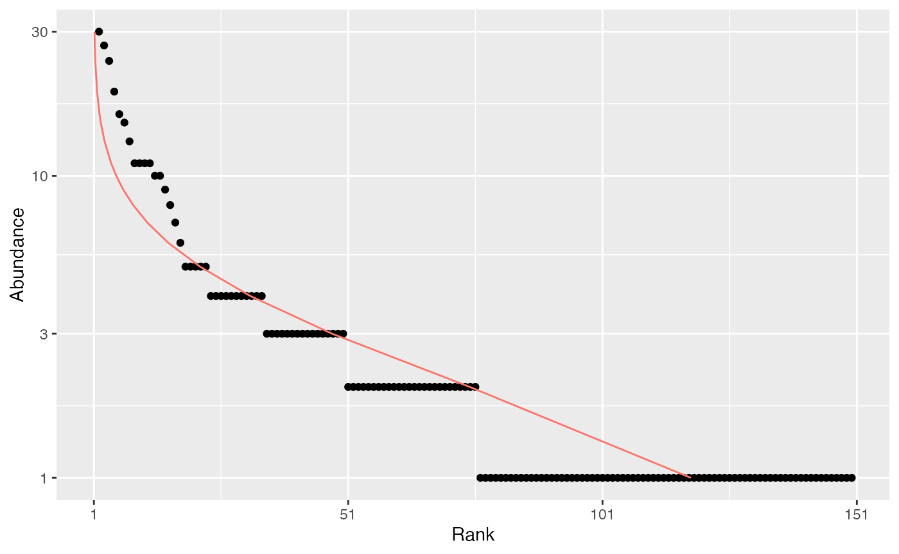
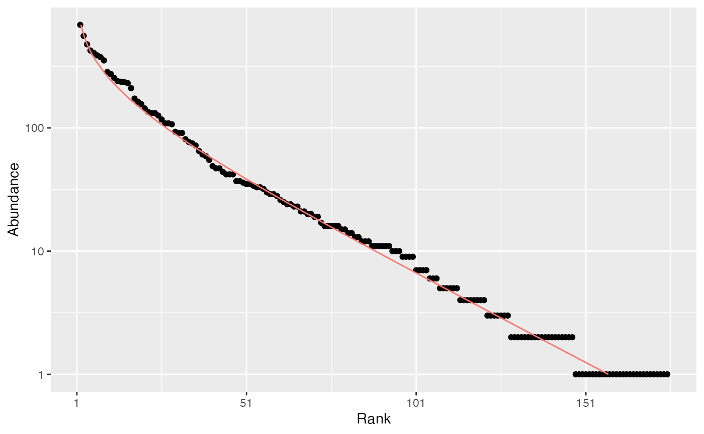
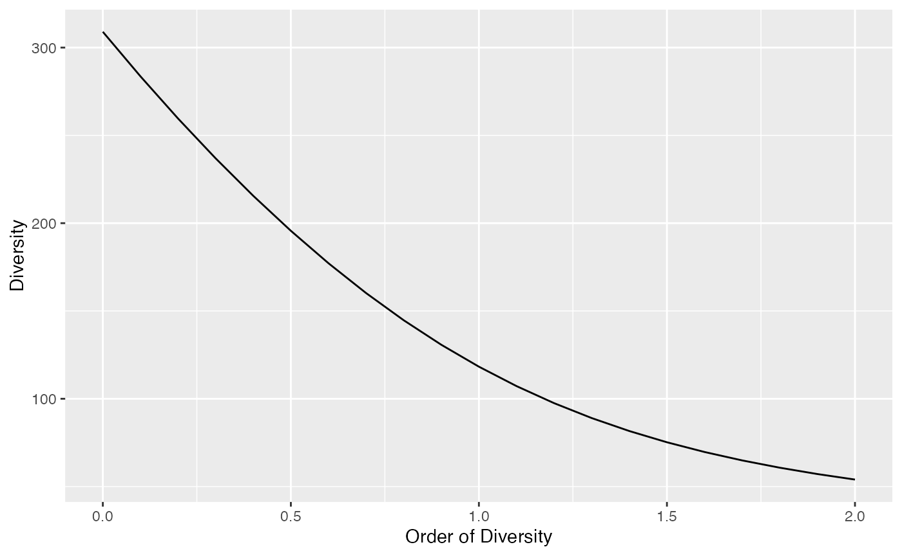
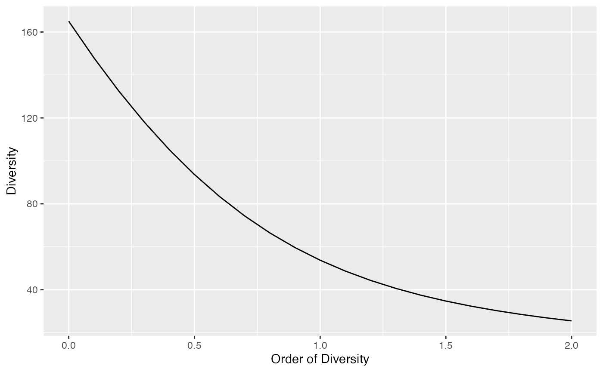
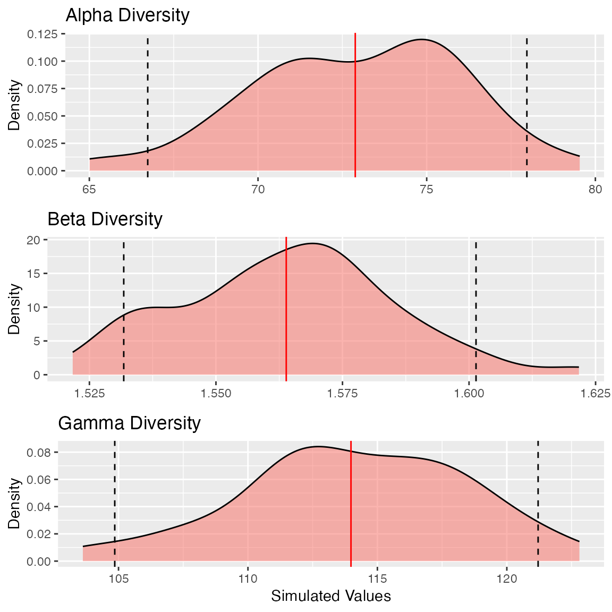
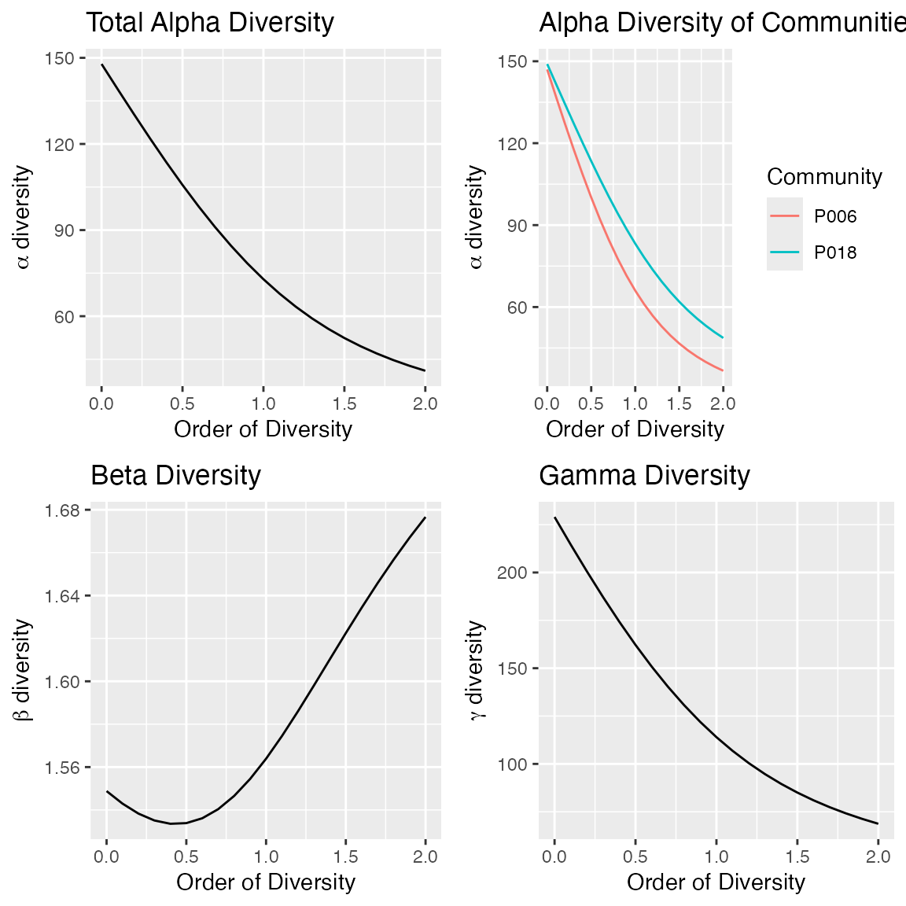

# entropart

*entropart* is a package for *R* designed to estimate diversity based on
HCDT entropy or similarity-based entropy. This is a short introduction
to its use.

The *entropart* package allows estimating biodiversity according to the
framework based on HCDT entropy, the correction of its estimation-bias
(Grassberger 1988; Chao and Shen 2003; Chao and Jost 2015) and its
transformation into equivalent numbers of species (Hill 1973; Jost 2006;
Marcon et al. 2014). Estimation of diversity at arbitrary levels of
sampling, requiring interpolation or extrapolation (Chao et al. 2014) is
available

Phylogenetic or functional diversity (Marcon and Hérault 2015) can be
estimated, considering phyloentropy as the average species-neutral
diversity over slices of a phylogenetic or functional tree (S. Pavoine,
Love, and Bonsall 2009).

Similarity-based diversity (Leinster and Cobbold 2012) can be used to
estimate (Marcon, Zhang, and Hérault 2014) functional diversity from a
similarity or dissimilarity matrix between species without requiring
building a dendrogram and thus preserving the topology of species
(Sandrine Pavoine, Ollier, and Dufour 2005; Podani and Schmera 2007).

The classical diversity estimators (Shannon and Simpson entropy) can be
found in many R packages. *vegetarian* (Charney and Record 2009) allows
calculating Hill numbers and partitioning them according to Jost’s
framework. Bias correction is rarely available except in the
*EntropyEstimation* (Cao and Grabchak 2014) package which provides the
Zhang and Grabchak’s estimators of entropy and diversity and their
asymptotic variance (not included in *entropart*).

## Estimating the diversity of a community

### Community data

Community data is a numeric vector containing abundances of species (the
number of individual of each species) or their probabilities (the
proportion of individuals of each species, summing to 1).

Example data is provided in the dataset `paracou618`. Let’s get the
abundances of tree species in the 1-ha tropical forest plot \#18 from
Paracou forest station in French Guiana:

``` r
library("entropart")
data("Paracou618")
N18 <- Paracou618.MC$Nsi[, "P018"]
```

The data in `Paracou618.MC` is a `MetaCommunity`, to be discovered
later. `N18` is a vector containing the abundances of 425 tree species,
among them some zero values. This is the most simple and common format
to provide data to estimate diversity. It can be used directly by the
functions presented here, but it may be declared explicitly as an
abundance vector to plot it, and possibly fit a well-known,
e.g. log-normal (Preston 1948), distribution of species abundance (the
red curve):

``` r
Abd18 <- as.AbdVector(N18)
autoplot(Abd18, Distribution="lnorm")
```



Abundance vectors can also be converted to probability vectors, summing
to 1:

``` r
P18 <- as.ProbaVector(N18)
```

The `rCommunity` function allows drawing random communities:

``` r
rc <- rCommunity(1, size=10000, Distribution = "lseries", alpha = 30)
autoplot(rc, Distribution="lseries")
```



The Whittaker plot of a random log-series (Fisher, Corbet, and Williams
1943) distribution of 10000 individuals simulated with parameter
$\alpha = 30$ is produced.

### Diversity estimation

The classical indices of diversity are richness (the number of species),
Shannon’s and Simpson’s entropies:

``` r
Richness(P18)
```

    ## None 
    ##  149

``` r
Shannon(P18)
```

    ##     None 
    ## 4.421358

``` r
Simpson(P18)
```

    ##      None 
    ## 0.9794563

When applied to a probability vector (created with `as.ProbaVector` or a
numeric vector summing to 1), no estimation-bias correction is applied:
this means that indices are just calculated by applying their definition
function to the probabilities (that is the plugin estimator).

When abundances are available (a numeric vector of integer values or an
object created by `as.ProbaVector`), several estimators are available
(Marcon 2015) to address unobserved species and the non-linearity of the
indices:

``` r
Richness(Abd18)
```

    ## Jackknife 3 
    ##         309

``` r
Shannon(Abd18)
```

    ##  UnveilJ 
    ## 4.772981

``` r
Simpson(Abd18)
```

    ##     Lande 
    ## 0.9814969

The best available estimator is chosen by default: its name is returned.

Those indices are special cases of the Tsallis entropy (1988) or order
$q$ (respectively $q = 0,1,2$ for richness, Shannon, Simpson):

``` r
Tsallis(Abd18, q=1)
```

    ##  UnveilJ 
    ## 4.772981

Entropy should be converted to its effective number of species, i.e. the
number of species with equal probabilities that would yield the observed
entropy, called Hill (1973) numbers or simply diversity (Jost 2006).

``` r
Diversity(Abd18, q=1)
```

    ##  UnveilJ 
    ## 118.2713

Diversity is the deformed exponential of order $q$ of entropy, and
entropy is the deformed logarithm of of order $q$ of diversity:

``` r
(d2 <- Diversity(Abd18,q=2))
```

    ##  UnveilJ 
    ## 53.97842

``` r
lnq(d2, q=2)
```

    ##   UnveilJ 
    ## 0.9814741

``` r
(e2 <-Tsallis(Abd18,q=2))
```

    ##   UnveilJ 
    ## 0.9814741

``` r
expq(e2, q=2)
```

    ##  UnveilJ 
    ## 53.97842

Diversity can be plotted against its order to provide a diversity
profile. Order 0 corresponds to richness, 1 to Shannon’s and 2 to
Simpson’s diversities:

``` r
DP <- CommunityProfile(Diversity, Abd18)
autoplot(DP)
```

    ## Warning: Using `size` aesthetic for lines was deprecated in ggplot2 3.4.0.
    ## ℹ Please use `linewidth` instead.
    ## ℹ The deprecated feature was likely used in the entropart package.
    ##   Please report the issue at <https://github.com/EricMarcon/entropart/issues/>.
    ## This warning is displayed once per session.
    ## Call `lifecycle::last_lifecycle_warnings()` to see where this warning was
    ## generated.



If an ultrametric dendrogram describing species’ phylogeny (here, a mere
taxonomy with family, genus and species) is available, phylogenetic
entropy and diversity (Marcon and Hérault 2015) can be calculated:

``` r
summary(PhyloDiversity(Abd18,q=1,Tree=Paracou618.Taxonomy))
```

    ## alpha or gamma phylogenetic or functional diversity of order 1 of distribution 
    ## Abd18
    ##  with correction: Best
    ## Phylogenetic or functional diversity was calculated according to the tree 
    ## Paracou618.Taxonomy 
    ## 
    ## Diversity is normalized
    ## 
    ## Diversity equals: 53.73643

With a Euclidian distance matrix between species, similarity-based
diversity (Leinster and Cobbold 2012; Marcon, Zhang, and Hérault 2014)
is available:

``` r
# Prepare the similarity matrix
DistanceMatrix <- as.matrix(Paracou618.dist)
# Similarity can be 1 minus normalized distances between species
Z <- 1 - DistanceMatrix/max(DistanceMatrix)
# Calculate diversity of order 2
Dqz(Abd18, q=2, Z)
```

    ##     Best 
    ## 1.477898

Profiles of phylogenetic diversity and similarity-based diversity are
obtained the same way. `PhyloDiversity` is an object with a lot of
information so an intermediate function is necessary to extract its
`$Total` component:

``` r
sbDP <- CommunityProfile(Dqz, Abd18, Z=Z)
pDP <- CommunityProfile(function(X, ...) PhyloDiversity(X, ...)$Total, Abd18, Tree=Paracou618.Taxonomy)
autoplot(pDP)
```



## Estimating the diversity of a meta-community

### Meta-community data

A meta-community is an object defined by the package. It is a set of
communities, each of them decribed by the abundance of their species and
their weight. Species probabilities in the meta-community are by
definition the weighted average of their probabilities in the
communities.

The easiest way to build a meta-community consists of preparing a
dataframe whose columns are communities and lines are species, and
define weights in a vector (by default, all weights are equal):

``` r
library("entropart")
(df <- data.frame(C1 = c(10, 10, 10, 10), C2 = c(0, 20, 35, 5), C3 = c(25, 15, 0, 2), row.names = c("sp1", "sp2", "sp3", "sp4")))
```

    ##     C1 C2 C3
    ## sp1 10  0 25
    ## sp2 10 20 15
    ## sp3 10 35  0
    ## sp4 10  5  2

``` r
w <- c(1, 2, 1)
```

The `MetaCommunity` function creates the meta-community. It can be
plotted:

``` r
MC <- MetaCommunity(Abundances = df, Weights = w)
plot(MC)
```


Each shade of grey represents a species. Heights correspond to the
probability of species and the width of each community is its weight.

`Paracou618.MC` is an example meta-community provided by the package. It
is made of two 1-ha communities (plots \#6 and \#18) of tropical forest.

### Diversity estimation

High level functions allow computing diversity of all communities
($\alpha$ diversity), of the meta-community ($\gamma$ diversity), and
$\beta$ diversity, i.e. the number of effective communities (the number
of communities with equal weights and no common species that would yield
the observed $\beta$ diversity).

The `DivPart` function calculates everything at once, for a given order
of diversity $q$:

``` r
p <- DivPart(q = 1, MC = Paracou618.MC)
summary(p)
```

    ## HCDT diversity partitioning of order 1 of metaCommunity Paracou618.MC
    ## 
    ## Alpha diversity of communities: 
    ##     P006     P018 
    ## 66.00455 83.20917 
    ## Total alpha diversity of the communities: 
    ## [1] 72.88247
    ## Beta diversity of the communities: 
    ##     None 
    ## 1.563888 
    ## Gamma diversity of the metacommunity: 
    ##   None 
    ## 113.98

The $\alpha$ diversity of communities is 73 effective species. $\gamma$
diversity of the meta-community is 114 effective species. $\beta$
diversity is 1.56 effective communities, i.e. the two actual communities
are as different from each other as 1.56 ones with equal weights and no
species in common.

The `DivEst` function decomposes diversity and estimates confidence
interval of $\alpha$, $\beta$ and $\gamma$ diversity following Marcon et
al. (2012). If the observed species frequencies of a community are
assumed to be a realization of a multinomial distribution, they can be
drawn again to obtain a distribution of entropy.

``` r
de <- DivEst(q = 1, Paracou618.MC, Simulations = 50)
```

``` r
# Margin adjustment required for this vignette html output
par(mar=c(1,1,2.2,1))
autoplot(de)
```



The result is a `Divest` object which can be summarized and plotted.

`DivProfile` calculates diversity profiles. The result is a `DivProfile`
object which can be summarized and plotted.

``` r
dp <- DivProfile(q.seq = seq(0, 2, 0.1), Paracou618.MC)
autoplot(dp)
```



Plot \#18 can be considered more diverse than plot \#6 because their
profiles (top right figure, plot \#18 is the dotted red line, plot \#6,
the solid black one) do not cross (Tothmeresz 1995): its diversity is
systematically higher. The shape of the $\beta$ diversity profile shows
that the communities are more diverse when their dominant species are
considered.

The bootstrap confidence intervals of the values of diversity (Marcon et
al. 2012, 2014) are calculated if `NumberOfSimulations` is not 0.

`DivPart`, `DivEst` and `DivProfile` use plugin estimators by default.
To force them to apply the same estimators as community functions, the
argument `Biased = FALSE` must be entered. They compute Tsallis entropy
and Hill numbers by default. A dendrogram in the argument `Tree` or a
similarity matrix in the argument `Z` will make them calculate
phylogenetic diversity or similarity-based diversity.

## Full documentation

<https://ericmarcon.github.io/entropart/>

## References

Cao, Lijuan, and Michael Grabchak. 2014. “EntropyEstimation.”
<https://cran.r-project.org/package=EntropyEstimation>.

Chao, Anne, Nicholas J. Gotelli, T. C. Hsieh, Elizabeth L. Sander, K. H.
Ma, Robert K. Colwell, and Aaron M. Ellison. 2014. “Rarefaction and
extrapolation with Hill numbers: A framework for sampling and estimation
in species diversity studies.” *Ecological Monographs* 84 (1): 45–67.
<https://doi.org/10.1890/13-0133.1>.

Chao, Anne, and Lou Jost. 2015. “Estimating Diversity and Entropy
Profiles via Discovery Rates of New Species.” *Methods in Ecology and
Evolution* 6 (8): 873–82.

Chao, Anne, and T. J. Shen. 2003. “Nonparametric Estimation of Shannon’s
Index of Diversity When There Are Unseen Species in Sample.”
*Environmental and Ecological Statistics* 10 (4): 429–43.

Charney, Noah, and Sydne Record. 2009. “Vegetarian: Jost Diversity
Measures for Community Data.”
<https://cran.r-project.org/package=vegetarian>.

Fisher, R. A., A. S. Corbet, and C. B. Williams. 1943. “The Relation
Between the Number of Species and the Number of Individuals in a Random
Sample of an Animal Population.” *Journal of Animal Ecology* 12: 42–58.

Grassberger, Peter. 1988. “Finite Sample Corrections to Entropy and
Dimension Estimates.” *Physics Letters A* 128 (6–7): 369–73.

Hill, M. O. 1973. “Diversity and Evenness: A Unifying Notation and Its
Consequences.” *Ecology* 54 (2): 427–32.

Jost, Lou. 2006. “Entropy and Diversity.” *Oikos* 113 (2): 363–75.

Leinster, Tom, and Christina Cobbold. 2012. “Measuring diversity: the
importance of species similarity.” *Ecology* 93 (3): 477–89.
<https://doi.org/10.1890/10-2402.1>.

Marcon, Eric. 2015. “Practical Estimation of Diversity from Abundance
Data.” *HAL* 01212435 (version 2).

Marcon, Eric, and Bruno Hérault. 2015. “Decomposing Phylodiversity.”
*Methods in Ecology and Evolution* 6 (3): 333–39.
<https://doi.org/10.1111/2041-210X.12323>.

Marcon, Eric, Bruno Hérault, Christopher Baraloto, and Gabriel Lang.
2012. “The Decomposition of Shannon’s Entropy and a Confidence Interval
for Beta Diversity.” *Oikos* 121 (4): 516–22.
<https://doi.org/10.1111/j.1600-0706.2011.19267.x>.

Marcon, Eric, Ivan Scotti, Bruno Hérault, Vivien Rossi, and Gabriel
Lang. 2014. “Generalization of the Partitioning of Shannon Diversity.”
*PLOS One* 9 (3): e90289.

Marcon, Eric, Zhiyi Zhang, and Bruno Hérault. 2014. “The Decomposition
of Similarity-Based Diversity and Its Bias Correction.” *HAL*
hal-00989454 (version 1): 1–12.

Pavoine, Sandrine, Sébastien Ollier, and Anne-Béatrice Dufour. 2005. “Is
the originality of a species measurable?” *Ecology Letters* 8: 579–86.
<https://doi.org/10.1111/j.1461-0248.2005.00752.x>.

Pavoine, S., M. S. Love, and M. B. Bonsall. 2009. “Hierarchical
Partitioning of Evolutionary and Ecological Patterns in the Organization
of Phylogenetically-Structured Species Assemblages: Application to
Rockfish (Genus: Sebastes) in the Southern California Bight.” *Ecology
Letters* 12 (9): 898–908.

Podani, János, and Dénes Schmera. 2007. “How should a dendrogram-based
measure of functional diversity function? A rejoinder to Petchey and
Gaston.” *Oikos* 116 (8): 1427–30.
<https://doi.org/10.1111/j.2007.0030-1299.16160.x>.

Preston, F. W. 1948. “The Commonness, and Rarity, of Species.” *Ecology*
29 (3): 254–83.

Tothmeresz, B. 1995. “Comparison of Different Methods for Diversity
Ordering.” *Journal of Vegetation Science* 6 (2): 283–90.

Tsallis, Constantino. 1988. “Possible Generalization of Boltzmann-Gibbs
Statistics.” *Journal of Statistical Physics* 52 (1): 479–87.
