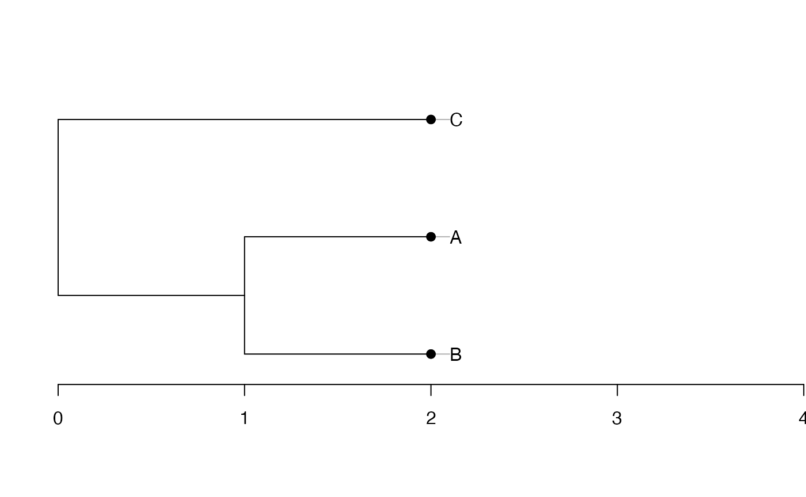

# Phylogenies in entropart

*entropart* is a package for *R* designed to estimate diversity based on
HCDT entropy or similarity-based entropy.

Several object classes can be used in *entropart* to represent
phylogenies and calculate phylogenetic diversity. They are detailed
here.

## Formats used

Supported phylogenies are classes `phylo` from package *ape*, `phylog`
from package *ade4* and `hclust` from package *base*.

To optimize performance, a specific class `PPtree`, for “preprocessed
trees”, is introduced by the package: it is basically a list containing
a `phylo` and an `hclust` representation of the phylogeny and
preprocessed useful statistics.

The arguments `Tree` or `PhyloTree` used in phylogenetic diversity
estimation functions of the package may be any of those formats.

## Conversion between classes

Let’s start from an ultrametric distance matrix. Three species are
defined, with distance 1 between the first 2 and distance 2 between both
and the last one.

``` r
dSp <- matrix(c(0, 1, 2, 1, 0, 2, 2, 2, 0), nrow=3, byrow=TRUE)
row.names(dSp) <- colnames(dSp) <- c("A", "B", "C")
dSp
```

    ##   A B C
    ## A 0 1 2
    ## B 1 0 2
    ## C 2 2 0

### hclust

An `hclust` object is created by UPGMA hierarchical clustering.

``` r
require("stats")
plot(hTree <- hclust(as.dist(dSp), method="average"), hang=-0.01, axes = F)
axis(2)
```


Node heights are stored in `$height`.

``` r
hTree$height
```

    ## [1] 1 2

### phylo

Conversion to a `phylo` object is straightforward.

``` r
require("ape")
```

    ## Loading required package: ape

``` r
plot(phyloTree <- as.phylo(hTree))
axis(1)
```


Edge lengths have been divided by 2 during the conversion, as documented
in [`?as.phylo.hclust`](https://rdrr.io/pkg/ape/man/as.phylo.html).

``` r
phyloTree$edge.length
```

    ## [1] 1.0 0.5 0.5 0.5

That does not suit our needs. In *entropart*, edge lengths are
multiplied by 2 after conversion, so that `phylo`objects can be
identical to other phylogenies.

``` r
phyloTree$edge.length <- 2*phyloTree$edge.length
plot(phyloTree)
axis(1)
```


### phylog

The last conversion is from `phylo` to `phylog`.

``` r
require("ade4")
```

    ## Loading required package: ade4

``` r
plot(phylogTree <- hclust2phylog(hTree))
axis(1)
```



Edge lengths are not stored directly in `phylog` objects. The `$droot`
component keeps distances from tips to root. The `$Wdist` component is a
`dist` (half a distance matrix without the zero-diagonal) whose values
are $d_{s,t} = \sqrt{2\delta_{s,t}^{2}}$, where $\delta_{s,t}$ is the
distance between species $s$ ant $t$.

``` r
phylogTree$droot
```

    ##    C    A    B Int1 Root 
    ##    2    2    2    1    0

``` r
phylogTree$Wdist^2/2
```

    ##   C A
    ## A 2  
    ## B 2 1

## Newick dendrograms

A Newick description of a dendrogram can be read into a `phylo` object.

``` r
NewickABC <- "(C:2,(A:1,B:1):1);"
plot(phyloABC <- ape::read.tree(text=NewickABC))
axis(1)
```


