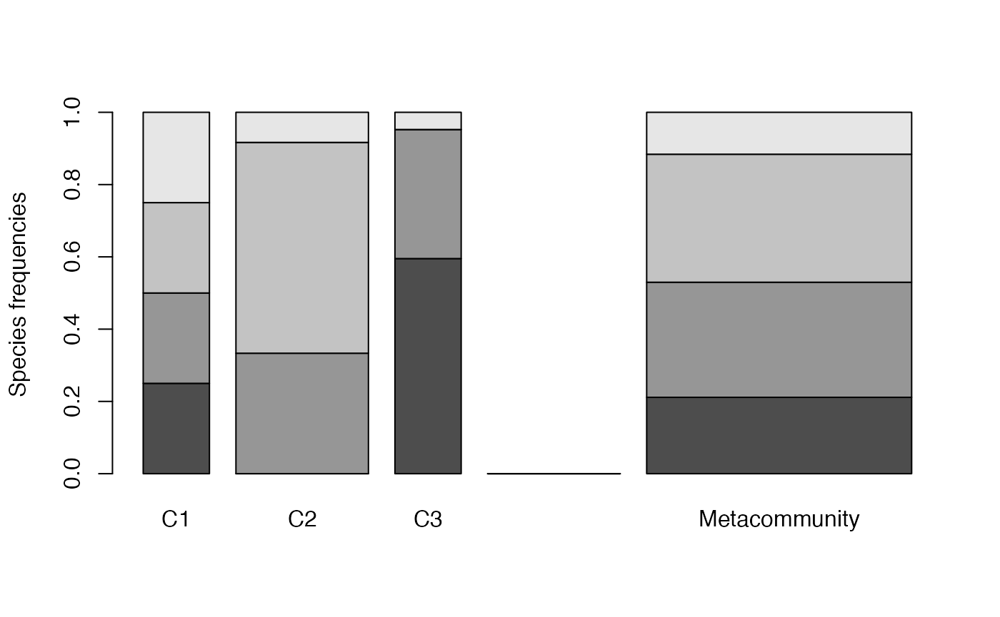
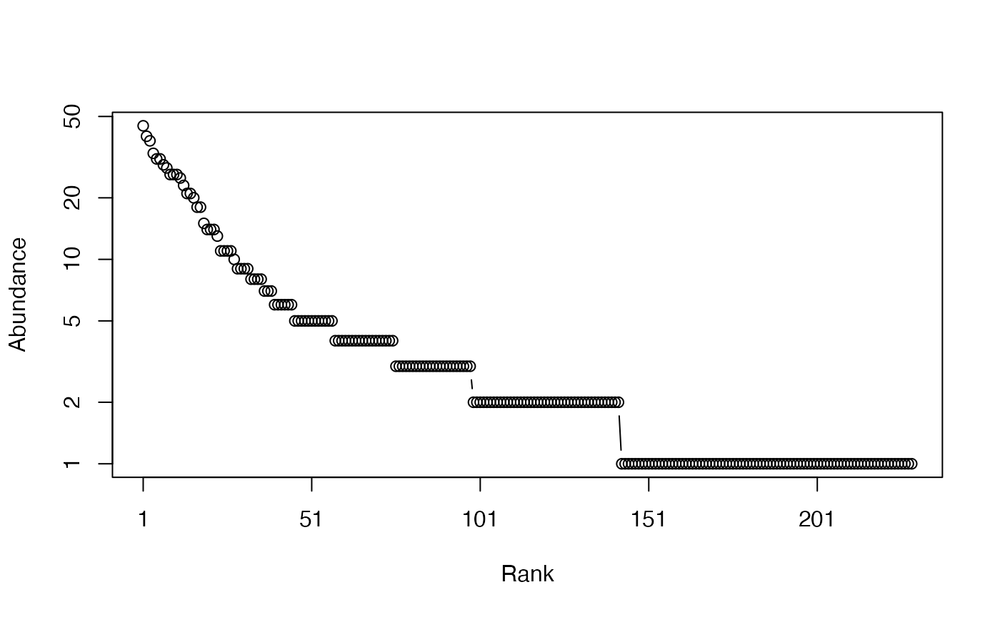
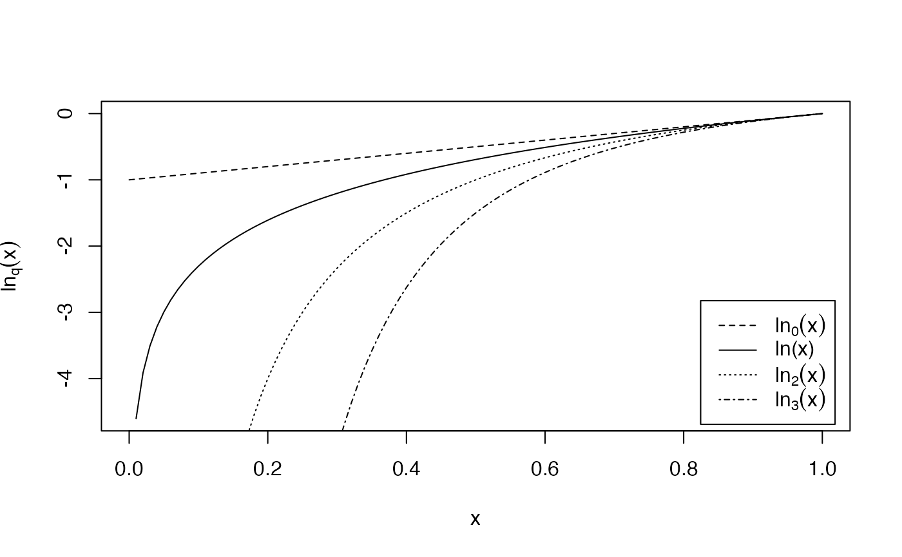
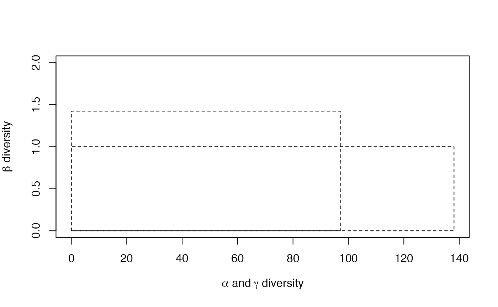
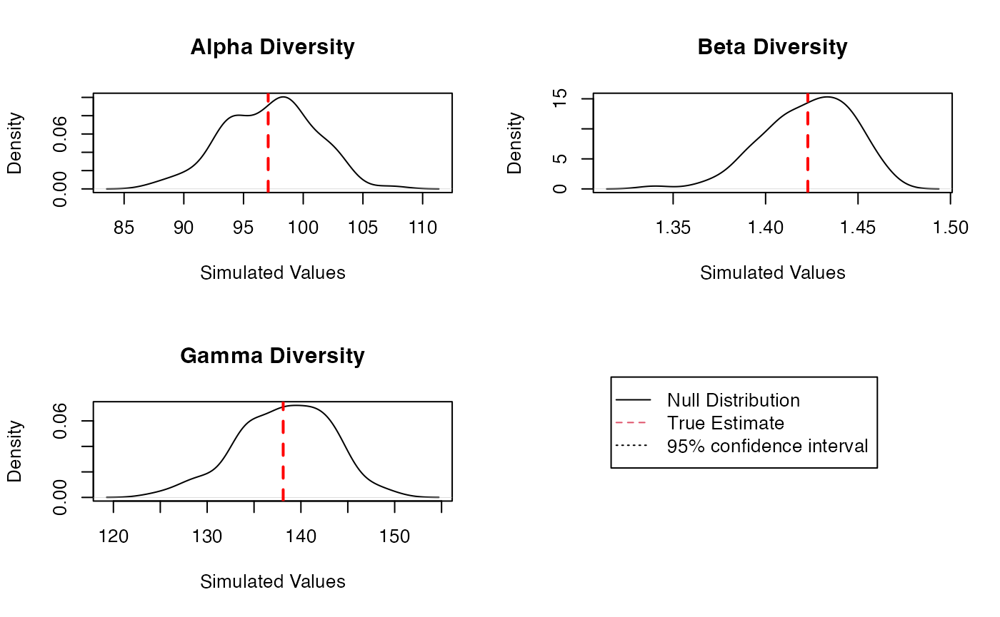
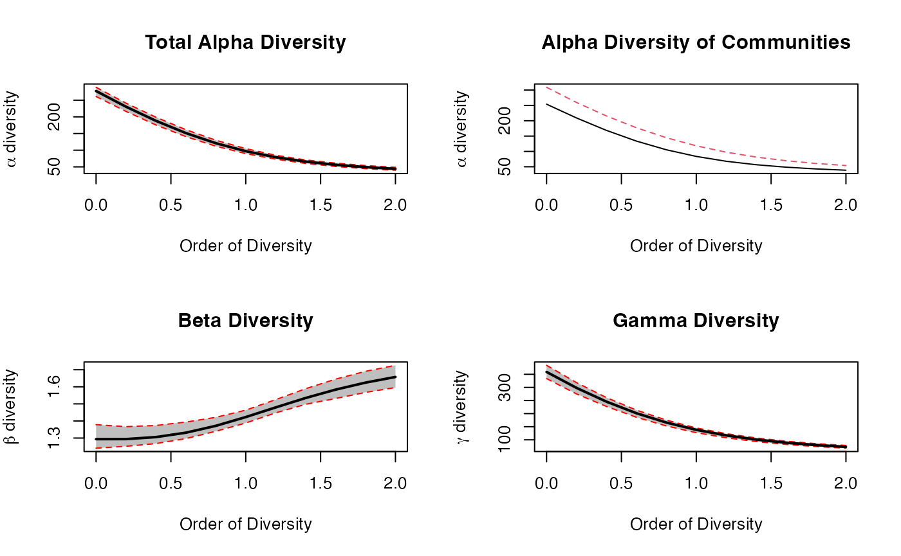
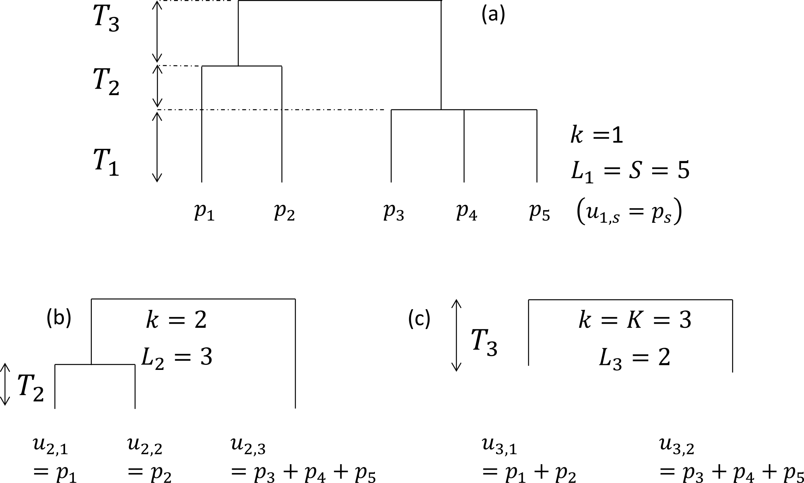
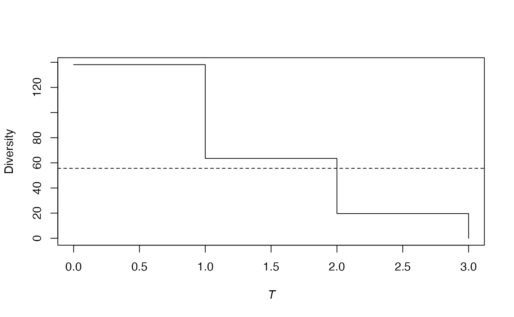
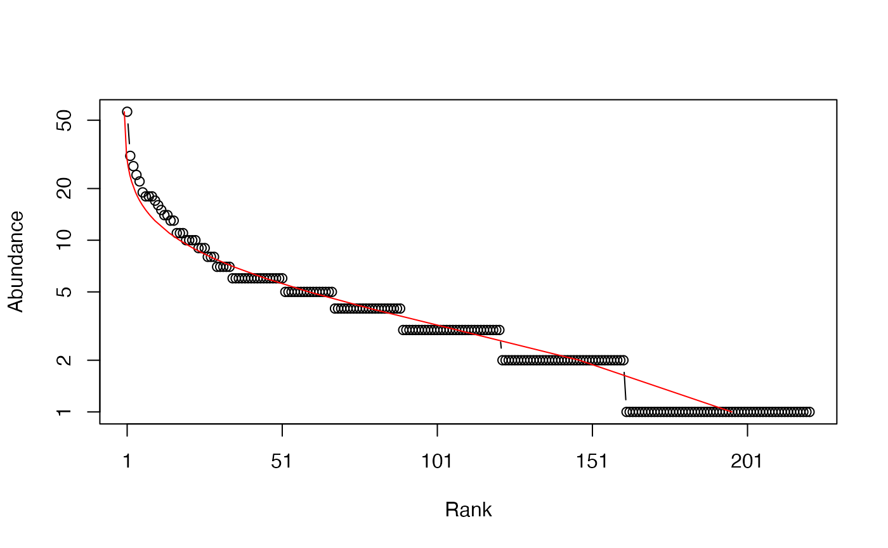
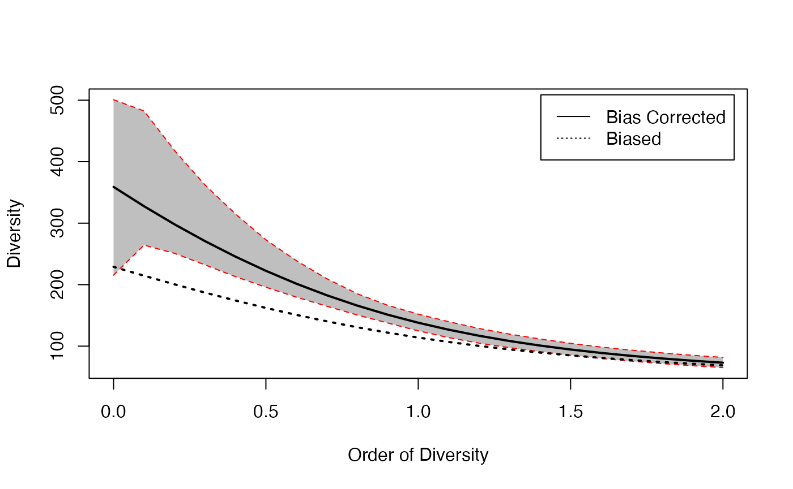

# entropart Package Reference

*entropart* is a package for *R* designed to estimate diversity based on
HCDT entropy or similarity-based entropy.

Diversity measurement can be done through a quite rigorous framework
based on entropy, i.e. the amount of uncertainty calculated from the
frequency distribution of a community (Patil and Taillie 1982; Jost
2006; Marcon et al. 2014). Tsallis entropy, also known as HCDT entropy
(Havrda and Charvát 1967; Daróczy 1970; Tsallis 1988), is of particular
interest (Jost 2006; Marcon et al. 2014) namely because it gathers the
number of species, Shannon (1948) and Simpson (1949) indices of
diversity into a single framework. Interpretation of entropy is not
straightforward but one can easily transform it into Hill numbers (Hill
1973) which have many desirable properties (Jost 2007): mainly, they are
the number of equally-frequent species that would give the same level of
diversity as the data.

Marcon and Hérault (2015a) generalized the duality of entropy and
diversity, deriving the relation between phylogenetic or functional
diversity (Chao, Chiu, and Jost 2010) and phylogenetic or functional
entropy (we will write *phylodiversity* and *phyloentropy* for short),
as introduced by Pavoine, Love, and Bonsall (2009). Special cases are
the well-known PD (Faith 1992) and FD (Petchey and Gaston 2002) indices
and Rao’s (1982) quadratic entropy. The same relation holds between
Ricotta and Szeidl’s entropy of a community (Ricotta and Szeidl 2006)
and similarity-based diversity (Leinster and Cobbold 2012).

The *entropart* package for R (R Core Team 2018) enables calculation of
all these measures of diversity and entropy and their partitioning.

Diversity partitioning means that, in a given area, the $\gamma$
diversity $D_{\gamma}$ of all individuals found may be split into within
($\alpha$ diversity, $D_{\alpha}$) and between ($\beta$ diversity,
$D_{\beta}$) local assemblages. $\alpha$ diversity reflects the
diversity of individuals *in* local assemblages whereas $\beta$
diversity reflects the diversity *of* the local assemblages. Marcon et
al. (2014) derived the decomposition of Tsallis $\gamma$ entropy into
its $\alpha$ and $\beta$ components, generalized to phylodiversity
(Marcon and Hérault 2015a) and similarity-based diversity (Marcon,
Zhang, and Hérault 2014).

Estimators of diversity are biased because of unseen species and also
because they are not linear functions of probabilities (Marcon et al.
2014). $\alpha$ and $\gamma$ diversities are underestimated by naive
estimators (Chao and Shen 2003; Dauby and Hardy 2012). $\beta$ diversity
is severely biased too when sampling is not sufficient (Beck, Holloway,
and Schwanghart 2013). Bias-corrected estimators of phylodiversity have
been developed by Marcon and Hérault (2015a). Estimators of
similarity-based diversity were derived by Marcon, Zhang, and Hérault
(2014). The package includes them all (Marcon and Hérault 2015b).

In summary, the framework supported by the package is as follows. First,
an information function is chosen to describe the amount of surprise
brought by the observation of each individual. In the simplest case of
species-neutral diversity, it is just a decreasing function of
probability: observing an individual of a rarer species brings more
surprise. Various information functions allow evaluating
species-neutral, phylogenetic or functional entropy. Surprise is
averaged among all individuals of a community to obtain its entropy.
Entropy is systematically transformed into diversity for interpretation.
Diversity is an effective number of species, i.e. the number of
equally-different and equally-frequent species that would give the same
entropy as the data. The average entropy of communities of an assemblage
is $\alpha$ entropy, while the entropy of the assemblage is $\gamma$
entropy. Their difference is $\beta$ entropy. After transformation,
$\beta$ diversity is the ratio of $\gamma$ to $\alpha$ diversity. It is
an effective number of communities, i.e. the number of equally-weighted
communities with no species in common (and where species are maximally
distinct between communities) necessary to obtain the same diversity as
the data. Estimation-bias correction is more easily applied to entropy
before transforming it into diversity.

This framework is somehow different from that of Chao, Chiu, and Jost
(2014) who define $\alpha$ diversity in another way (see Marcon and
Hérault 2015a for a detailed comparison), such that $\alpha$ entropy is
not the average surprise of an assemblage. They also propose a
definition of functional diversity (Chiu and Chao 2014) based in the
information brought by pairs of individuals that is not supported in the
package.

The successive sections of this paper presents the package features,
illustrated by worked examples based on the data included in the
package.

## Package organization

### Data

Most functions of the package calculate entropy or diversity of a
community or of an assemblage of communities called a *meta-community*.
Community functions accept a vector of probabilities or of abundances
for species data. Each element of the vector contains the probability or
the number of occurrences of a species in a given community.
Meta-community functions require a particular data organization in a
`MetaCommunity` object described here.

A `MetaCommunity` is basically a list. Its main components are `$Nsi`, a
matrix containing the species abundances whose lines are species,
columns are communities and `$Wi`, a vector containing community
weights. Creating a `MetaCommunity` object is the purpose of the
`MetaCommunity` function. Arguments are a dataframe containing the
number of individuals per species (lines) in each community (columns),
and a vector containing the community weights. The following example
creates a `MetaCommunity` made of three communities of unequal weights
with 4 species. The weighted average probabilities of occurrence of
species and the total number of individuals define the meta-community as
the assemblage of communities.

``` r
library("entropart")
df <- data.frame(C1=c(10, 10, 10, 10), C2=c(0, 20, 35, 5), C3=c(25, 15, 0, 2))
row.names(df) <- c("sp1", "sp2", "sp3", "sp4")
df
```

    ##     C1 C2 C3
    ## sp1 10  0 25
    ## sp2 10 20 15
    ## sp3 10 35  0
    ## sp4 10  5  2

``` r
w <- c(1, 2, 1)
MC <- MetaCommunity(Abundances=df, Weights=w)
plot(MC)
```



Communities (named C1, C2 ad C3) are represented in the left part of the
figure, the metacommunity to the right. Bar widths are proportional to
community weights. Species abundances are represented vertically (4
species are present in the meta-community, only 3 of them in communities
C2 and C3).

A meta-community is partitioned into several local communities (indexed
by $i = 1,2,\ldots,I$). $n_{i}$ individuals are sampled in community
$i$. Let $s = 1,\ 2,\ldots,S$ denote the species that compose the
meta-community, $n_{s,i}$ the number of individuals of species $s$
sampled in the local community $i$, $n_{s} = \sum_{i}n_{s,i}$ the total
number of individuals of species $s$, $n = \sum_{s}{\sum_{i}n_{s,i}}$
the total number of sampled individuals. Within each community $i$, the
probability $p_{s,i}$ for an individual to belong to species $s$ is
estimated by ${\widehat{p}}_{s,i} = n_{s,i}/n_{i}$. The same probability
for the meta-community is $p_{s}$.

Communities have a weight $w_{i}$, satisfying
$p_{s} = \sum_{i}{w_{i}p_{s,i}}$. The commonly-used $w_{i} = n_{i}/n$ is
a possible weight, but the weighting may be arbitrary (e.g. the sampled
areas). The component `$Ps` of a `MetaCommunity` object contains the
probability of occurrence of each species in the meta-community,
calculated this way:

``` r
MC$Ps
```

    ##       sp1       sp2       sp3       sp4 
    ## 0.2113095 0.3184524 0.3541667 0.1160714

The number of individuals `$Ns` of a `MetaCommunity` is theoretically
unknown, since communities are just samples of it. The total number of
individuals is `$N`. For simplicity, it is set to the total number of
individuals of all communities. If community weights are their number of
individuals, `$Ns` is just the sum of the numbers of individuals per
species of communities. Else, `$Ns` may contain non-integer values,
respecting the probabilities `$Ps` and summing to `$N`.

A `MetaCommunity` can be summarized and plotted.

The package contains an example dataset containing the inventory of two
1-ha tropical forest plots in Paracou, French Guiana (Marcon et al.
2012):

``` r
data("Paracou618")
summary(Paracou618.MC)
```

    ## Meta-community (class 'MetaCommunity') made of 1124 individuals in 2 
    ## communities and 425 species. 
    ## 
    ## Its sample coverage is 0.92266748426447 
    ## 
    ## Community weights are: 
    ## [1] 0.5720641 0.4279359
    ## Community sample numbers of individuals are: 
    ## P006 P018 
    ##  643  481 
    ## Community sample coverages are: 
    ##      P006      P018 
    ## 0.8943859 0.8463782

`Paracou618.MC` is a meta-community made of two communities named *P006*
and *P018*, containing 425 species (their name is
*Family_Genus_Species*, abbreviated to 4 characters). The values of the
abundance matrix are the number of individuals of each species in each
community. Sample coverage will be explained later.

The dataset also contains a taxonomy and a functional tree.
`Paracou618.Taxonomy` is an object of class `phylo`, defined in the
package *ape* (Paradis, Claude, and Strimmer 2004), namely a
phylogenetic tree. This example data is only a taxonomy, containing
family, genus and species levels for the sake of simplicity.
`Paracou618.Functional` is an object of class `hclust` containing a
functional tree based on leaf, height, stem and seed functional traits
(Hérault and Honnay 2007; Marcon and Hérault 2015a). The package also
accepts any ultrametric tree of class `phylog`, from *ade4* (Dray and
Dufour 2007) or `hclust`. `Paracou618.dist` is the distance matrix
(actually a `dist` object) used to build the functional tree.

Numeric vectors containing species abundances (such as the `$Ns`
component of `MetaCommunity`) or probabilities (such as `$Ps`) may be
converted to abundance vectors (`AbdVector`) or probability vectors
(`ProbaVector`) to clarify their content. By default, the `as.AbdVector`
function transforms abundance values into integer if they are not (the
`$Ns` components of a `MetaCommunity` is typically not an integer vector
if community weights are not proportional to their numbers of
individuals):

``` r
data("Paracou618")
PAbd <- as.AbdVector(Paracou618.MC$Ns)
plot(PAbd)
```



the Paracou species distribution is plotted as a Rank-Abundance Curve
(Whittaker plot).

The `as.ProbaVector` function transforms abundances to probabilities if
necessary:

``` r
PProba <- as.ProbaVector(Paracou618.MC$Ps)
```

`AbdVector` and `ProbaVector` objects both are `SpeciesDistribution`
objects which can be plotted.

### Utilities

The deformed logarithm formalism (Tsallis 1994) is very convenient to
manipulate entropies. The deformed logarithm of order $q$ is defined as:

$$\ln_{q}x = \frac{x^{1 - q} - 1}{1 - q}$$

It converges to $\ln$ when $\left. q\rightarrow 1 \right.$.

``` r
curve(log(x), 0, 1, lty=1, ylab = expression(ln[q](x)))
curve(lnq(x, 0), 0, 1, lty = 2, add = TRUE)
curve(lnq(x, 2), 0, 1, lty = 3, add = TRUE)
curve(lnq(x, 3), 0, 1, lty = 4, add = TRUE)  
legend("bottomright", legend = c(expression(ln[0](x)), "ln(x)", expression(ln[2](x)), expression(ln[3](x))), lty = c(2, 1, 3, 4), inset=  0.02)
```



The figure shows the curves of $\ln_{q}x$ for different values of $q$
between 0 and 4 ($\ln_{1}x = \ln x$).

The inverse function of $\ln_{q}x$ is the deformed exponential:

$$e_{q}^{x} = \left\lbrack 1 + (1 - q)x \right\rbrack^{\frac{1}{1 - q}}$$

Functions of the package are `lnq(x, q)` and `expq(x, q)`.

## Species-neutral diversity

### Community functions

#### HCDT entropy

Species-neutral HCDT entropy of order $q$ of a community is defined as:

$$^{q}\! H = \frac{1 - \sum\limits_{s}p_{s}^{q}}{q - 1} = - \sum\limits_{s}p_{s}^{q}\ln_{q}p_{s} = \sum\limits_{s}p_{s}\ln_{q}\frac{1}{p_{s}}$$

$q$ is the order of diversity (e.g.: 1 for Shannon). Entropy can be
calculated by the `Tsallis` function. Paracou meta-community entropy of
order 1 is:

``` r
Tsallis(PProba, q = 1)
```

    ##     None 
    ## 4.736023

For convenience, special cases of entropy of order $q$ have a clear-name
function: `Richess` for $q = 0$, `Shannon` for $q = 1$, `Simpson` for
$q = 2$.

``` r
Shannon(PProba)
```

    ##     None 
    ## 4.736023

Entropy values have no intuitive interpretation in general, except for
the number of species $^{0}\! H$ and Simpson entropy $^{2}\! H$ which is
the probability for two randomly chosen individuals to belong to
different species.

#### Sample coverage

A useful indicator of sampling quality is the sample coverage (Good
1953; Chao, Lee, and Chen 1988; Zhang and Huang 2007), that is to say
the probability for a species of the community to be observed in the
actual sample. It equals the sum of the probability of occurrences of
all observed species. Its historical estimator is (Good 1953):

$$\widehat{C} = 1 - \frac{S^{1}}{n}$$

$S^{1}$ is the number of singletons (species observed once) of the
sample, and $n$ is its size. The estimator has been improved by taking
into account the whole distribution of species (Zhang and Huang 2007).
The `Coverage` function calculates it, allowing to choose the estimator:

``` r
Coverage(PAbd)
```

    ## ZhangHuang 
    ##  0.9226675

The sample coverage cannot be estimated from probability data:
abundances are required.

Its interpretation is straightforward: some species have not been
sampled. Their number is unknown but their total probability of
occurence can be estimated accurately. Here, it is a bit less than 8%.
From another point of view, the probability for an individual of the
community to belong to a sampled species is $C$: 8% of them belong to
missed species. The number of missed species may be estimated by
`Richness` but this is not the point here. The sample coverage is the
foundation of many estimators of entropy.

#### Bias corrected estimators

Correction of estimation bias is used to improve the estimation of
entropy despite unobserved species and also mathematical issues
(Bonachela, Hinrichsen, and Muñoz 2008). Bias-corrected estimators
(often relying on sample coverage) are returned by functions whose names
are prefixed by `bc`, such as `bcTsallis`. They are similar to the
non-corrected ones but they use abundance data and propose several
bias-correction techniques to select in the `Correction` argument. A
*Best* correction is calculated by default, detailed in the help file of
each function.

``` r
bcTsallis(PAbd, q = 1)
```

    ##  UnveilJ 
    ## 4.928035

The best correction for Tsallis entropy follows Chao and Jost (2015). It
combines an unbiased estimator previously derived by Zhang and Grabchak
(2016) and an estimate of the remaining bias.

All community functions such as `Tsallis` are actually generic methods
that can handle several types of data the appropriate way: if the first
argument of the function is a `ProbaVector` (or a numeric vector summing
to 1), no bias correction is applied. If it is an `AbdVector` (or an
integer vector), the bias-corrected estimator is used
(e.g. `bcTsallis`). Numeric vectors summing to more than 2 are
considered as abundances but most bias corrections do not allow
non-integer values and return a warning.

The different ways to use the functions are a matter of personal
preference. `bcTsallis` is equivalent to `Tsallis` with an abundance
vector:

``` r
Tsallis(PAbd, q = 1)
```

    ##  UnveilJ 
    ## 4.928035

whilst `Tsallis` with a probability vector does not allow bias
correction:

``` r
Tsallis(PProba, q = 1)
```

    ##     None 
    ## 4.736023

Bias-corrected entropy is ready to be transformed into explicit
diversity.

#### Effective numbers of species

Entropy should be converted into *true diversity* (Jost 2007),
i.e. effective number of species equal to Hill (1973) numbers:

$$^{q}\! D = \left( \sum\limits_{s}p_{s}^{q} \right)^{\frac{1}{1 - q}}$$

This can be done by the deformed exponential function, or using directly
the `Diversity` or `bcDiversity` functions (equal to the deformed
exponential of order $q$ of `Tsallis` or `bcTsallis`)

``` r
expq(Tsallis(PAbd, q = 2), q = 2)
```

    ##  UnveilJ 
    ## 73.09335

``` r
Diversity(PAbd, q = 2)
```

    ##  UnveilJ 
    ## 73.09335

The effective number of species of the Paracou dataset is estimated to
be 73 after bias correction (rather than 69 without it). It means that a
community made of 73 equally-frequent species has the same Simpson
entropy as the actual one. This is much less than the actual 425 sampled
species. Simpson’s entropy focuses on dominant species.

#### Hurlbert’s diversity

Hurlbert’s index of diversity (Hurlbert 1971) of order $k$ is the
expected number of species observed in a sample of size $k$.

$$_{k}\! S = \sum\limits_{s}\left\lbrack 1 - \left( 1 - p_{s} \right)^{k} \right\rbrack$$

Greater values of $k$ give more importance to rare species.

An unibiased estimator of $_{k}\! S$ has been provided by Hurlbert, for
values of $k$ up to the sample size $n$:

$$_{k}\!\widehat{S} = \sum\limits_{s}\left\lbrack 1 - \left( \frac{n - n_{s}}{k} \right)/\left( \frac{n}{k} \right) \right\rbrack$$

The effective number of species $_{k}\! D$ can be found by solving the
following equation (Dauby and Hardy 2012):

$$_{k}\! S = {_{k}\! D}\left\lbrack 1 - \left( 1 - \frac{1}{_{k}\! D} \right)^{k} \right\rbrack$$

Hurlbert’s index is calculated by the `Hurlbert` function. Its unbiased
estimator is obtained by `bcHurlbert` (implicitly if an abundance vector
is used). Its effective number of species is caclulated by `HurlbertD`
or `bcHurlbertD`.

``` r
Hurlbert(PProba, k = 2)
```

    ##   Biased 
    ## 1.985449

``` r
Hurlbert(PAbd, k = 2)
```

    ## Unbiased 
    ## 1.986326

``` r
HurlbertD(PAbd, k = 2)
```

    ## Unbiased 
    ## 73.13163

Hurlbert’s diversity of order 2 is identical to Simpson’s diversity.

### Meta-community functions

Meta-community functions allow partitioning diversity according to Patil
and Taillie’s concept of diversity of a mixture (Patil and Taillie
1982), i.e. $\alpha$ entropy of a meta-community is defined as the
weighted average of community entropy, following Routledge (1979):

$$^{q}\! H_{\alpha} = \sum\limits_{i}w_{i}\,_{i}^{q}H_{\alpha}$$

$_{i}^{q}H_{\alpha}$ is the entropy of community $i$:

$$_{i}^{q}\! H_{\alpha} = \frac{1 - \sum\limits_{s}p_{s,i}^{q}}{q - 1} = - \sum\limits_{s}p_{s,i}^{q}\ln_{q}p_{s,i} = \sum\limits_{s}p_{s,i}\ln_{q}\frac{1}{p_{s,i}}$$

Jost’s (2007) definition of $\alpha$ entropy is not supported explicitly
in the package since it only allows partitioning of equally weighted
communities. In this particular case, both definitions are identical.

$\gamma$ entropy of the meta-community is defined as $\alpha$ entropy of
a community. $\beta$ entropy, the difference between $\gamma$ and
$\alpha$, is the generalized Jensen-Shannon divergence between the
species distribution of the meta-community and those of communities
(Marcon et al. 2014):

$$^{q}\! H_{\beta} =^{q}\! H_{\gamma} -^{q}\! H_{\alpha} = \sum\limits_{s}{p_{s,i}^{q}\ln_{q}\frac{p_{s,i}}{p_{s}}} = \sum\limits_{s}{p_{s,i}\ln_{q}\frac{p_{s}}{p_{s,i}}}$$

$\beta$ entropy should be transformed into diversity, i.e. an effective
number of communities:
$$^{q}\! D_{\beta} = e_{q}^{\frac{^{q}\! H_{\beta}}{1 - {(q - 1)}^{q}\! H_{\alpha}}}$$

#### Basic meta-community functions

These values can be estimated by the meta-community functions named
`AlphaEntropy`, `AlphaDiversity`, `BetaEntropy`, `BetaDiversity`. They
accept a `Metacommunity` and an order of diversity $q$ as arguments, and
return an `MCentropy` or `MCdiversity` object which can be summarized
and plotted. `GammaEntropy` and `GammaDiversity` return a number.
Estimation-bias corrections are applied by default:

``` r
e <- AlphaEntropy(Paracou618.MC, q = 1)
summary(e)
```

    ## Neutral alpha entropy of order 1 of metaCommunity Paracou618.MC 
    ## with correction: Best 
    ## 
    ## Entropy of communities: 
    ##     P006     P018 
    ## 4.427559 4.772981 
    ## Average entropy of the communities: 
    ## [1] 4.575378

The Shannon $\alpha$ entropy of the meta-community is 4.58. It is the
weighted average entropy of communities.

The estimation of the diversity of a meta-community whose numbers of
individuals`$Ns` are not integer values can’t be done with most
corrections, which do require integers. The Grassberger correction can
be used. Community data is pooled to obtain a global inventory whose
sample coverage is estimated. The Chao-Shen correction can also be
applied based on this sample coverage and the actual `$Ps` values of the
meta-community. Finally, the *Best* correction is the greater of the two
values obtained by Chao-Shen and Grassberger (Marcon et al. 2014).

#### Diversity Partition of a metacommunity

The `DivPart` function calculates everything at once. Its arguments are
the same but bias correction is not applied by default. It can be, using
the argument `Biased = FALSE`, and the correction chosen by the
argument`Correction`. It returns a `DivPart` object which can be
summarized (entropy is not printed by `summary`) and plotted:

``` r
p <- DivPart(q = 1, MC = Paracou618.MC, Biased = FALSE)
summary(p)
```

    ## HCDT diversity partitioning of order 1 of metaCommunity Paracou618.MC
    ##  with correction: UnveilJ
    ## Alpha diversity of communities: 
    ##     P006     P018 
    ##  83.7268 118.2713 
    ## Total alpha diversity of the communities: 
    ## [1] 97.06467
    ## Beta diversity of the communities: 
    ##  UnveilJ 
    ## 1.422843 
    ## Gamma diversity of the metacommunity: 
    ##  UnveilJ 
    ## 138.1078

``` r
p$CommunityAlphaEntropies
```

    ##     P006     P018 
    ## 4.427559 4.772981

``` r
plot(p)
```



The $\alpha$ diversity of communities is 97 effective species (it is the
exponential of the entropy calculated previously). This is more than
Simpson’s diversity 73 species, calculated above) because less frequent
species are taken into account. $\gamma$ diversity of the meta-community
is 138 effective species. $\beta$ diversity is 1.42 effective
communities, i.e. the two actual communities are as different from each
other as 1.42 ones with equal weights and no species in common.

The figure is the plot of the diversity partition of the meta-community
`Paracou618.MC`. The long rectangle of height 1 represents $\gamma$
diversity, equal to 138 effective species. The narrower and higher
rectangle has the same area: its horizontal size is $\alpha$ diversity
(97 effective species) and its height is $\beta$ diversity (1.42
effective communities).}

#### Diversity Estimation of a metacommunity

The `DivEst` function decomposes diversity and estimates confidence
interval of $\alpha$, $\beta$ and $\gamma$ diversity following Marcon et
al. (2012). If the observed species frequencies of a community are
assumed to be a realization of a multinomial distribution, they can be
drawn again to obtain a distribution of entropy.

``` r
de <- DivEst(q = 1, Paracou618.MC, Biased = FALSE, Correction = "Best", Simulations = 100)
```

``` r
summary(de)
```

    ## Diversity partitioning of order 1 of MetaCommunity Paracou618.MC
    ##  with correction: UnveilJ
    ## Alpha diversity of communities: 
    ##     P006     P018 
    ##  83.7268 118.2713 
    ## Total alpha diversity of the communities: 
    ## [1] 97.06467
    ## Beta diversity of the communities: 
    ##  UnveilJ 
    ## 1.422843 
    ## Gamma diversity of the metacommunity: 
    ##  UnveilJ 
    ## 138.1078 
    ## Quantiles of simulations (alpha, beta and gamma diversity):
    ##        0%        1%      2.5%        5%       10%       25%       50%       75% 
    ##  87.56992  88.57301  89.77042  90.88598  92.77112  94.15624  97.58370  99.41126 
    ##       90%       95%     97.5%       99%      100% 
    ## 102.20997 102.87662 103.23507 103.88128 107.32784 
    ##       0%       1%     2.5%       5%      10%      25%      50%      75% 
    ## 1.339922 1.363803 1.374749 1.385619 1.391839 1.407480 1.425706 1.441064 
    ##      90%      95%    97.5%      99%     100% 
    ## 1.450534 1.458070 1.461556 1.462083 1.467843 
    ##       0%       1%     2.5%       5%      10%      25%      50%      75% 
    ## 124.5689 126.6940 127.9634 129.4314 132.5082 134.4105 138.2225 141.7209 
    ##      90%      95%    97.5%      99%     100% 
    ## 143.8710 144.4679 146.9598 148.2705 149.4250

``` r
plot(de)
```

    ## Warning in int_abline(a = a, b = b, h = h, v = v, untf = untf, ...): NAs
    ## introduced by coercion
    ## Warning in int_abline(a = a, b = b, h = h, v = v, untf = untf, ...): NAs
    ## introduced by coercion
    ## Warning in int_abline(a = a, b = b, h = h, v = v, untf = untf, ...): NAs
    ## introduced by coercion
    ## Warning in int_abline(a = a, b = b, h = h, v = v, untf = untf, ...): NAs
    ## introduced by coercion
    ## Warning in int_abline(a = a, b = b, h = h, v = v, untf = untf, ...): NAs
    ## introduced by coercion
    ## Warning in int_abline(a = a, b = b, h = h, v = v, untf = untf, ...): NAs
    ## introduced by coercion



The result is a `Divest` object which can be summarized and plotted. On
the figure of the diversity estimation of the meta-community
`Paracou618.MC`, $\alpha$, $\beta$ and $\gamma$ diversity probability
densities are plotted, with a 95% confidence interval.

The uncertainty of estimation is due to sampling: the distribution of
the estimators corresponds to the simulated repetitions of sampling in
the original multinomial distribution of species. It ignores the
remaining bias of the estimator, which is unknown. Yet, except for
$q = 2$, the corrected estimators *are* biased (even though much less
than the non-corrected ones), especially when $q$ is small. New
estimators to reduce the bias are included in the package regularly.

#### Diversity Profile of a metacommunity

`DivProfile` calculates diversity profiles, i.e. the value of diversity
against its order. The result is a `DivProfile` object which can be
summarized and plotted.

``` r
dp <- DivProfile(seq(0, 2, 0.2), Paracou618.MC, Biased = FALSE, NumberOfSimulations = 20)
```

``` r
summary(dp)
```

    ## Diversity profile of MetaCommunity Paracou618.MC
    ##  with correction: UnveilJ
    ## Diversity against its order:
    ##         Order Alpha Diversity Beta Diversity Gamma Diversity
    ## UnveilJ   0.0       277.53648       1.293524       359.00000
    ## UnveilJ   0.2       230.43524       1.293933       298.16776
    ## UnveilJ   0.4       188.11846       1.305629       245.61294
    ## UnveilJ   0.6       151.41091       1.331320       201.57635
    ## UnveilJ   0.8       121.00956       1.371445       165.95797
    ## UnveilJ   1.0        97.06467       1.422843       138.10783
    ## UnveilJ   1.2        79.01317       1.479377       116.89026
    ## UnveilJ   1.4        65.79132       1.534463       100.95435
    ## UnveilJ   1.6        56.21256       1.583490        89.01206
    ## UnveilJ   1.8        49.24224       1.624534        79.99569
    ## UnveilJ   2.0        44.09399       1.657672        73.09335

``` r
plot(dp)
```



The figure shows the diversity profile of the meta-community
`Paracou618.MC`. Values are the number of effective species ($\alpha$
and $\gamma$ diversity) and the effective number of communities ($\beta$
diversity). Community P006 is represented by the solid line and
community P018 by the dotted line. $\alpha$ and $\gamma$ diversity
decrease from $q = 0$ (number of species) to $q = 2$ (Simpson diversity)
by construction.}

Small orders of diversity give more weight to rare species. P018 can be
considered more diverse than P006 because their profiles (top right of
the figure) do not cross (Tothmeresz 1995): its diversity is
systematically higher. The shape of the $\beta$ diversity profile shows
that the communities are more diverse when their dominant species are
considered.

The bootstrap confidence intervals of the values of diversity (Marcon et
al. 2012, 2014) are calculated if `NumberOfSimulations` is not 0.

#### Alternative functions

Beta entropy can also be calculated by a set of functions named after
the community functions, such as `TsallisBeta`, `bcTsallisBeta`,
`SimpsonBeta`, etc. which require two vectors of abundances or
probabilities instead of a `MetaCommunity` object: that of the community
and the expected one (usually that of the meta-community). Bias
correction is currently limited to Chao and Shen’s correction. The
example below calculates the Shannon $\beta$ entropy of the first
community of Paracou618 and the meta-community.

``` r
ShannonBeta(Paracou618.MC$Psi[, 1], PProba)
```

    ##      None 
    ## 0.3499358

These functions are available for particular uses, when a
`MetaCommunity` is not available or not convenient to use
(e.g. simulations). Meta-community functions are preferred in general.

## Phylogenetic diversity

Phylogenetic or functional diversity generalizes HCDT diversity,
considering the distance between species (Marcon and Hérault 2015a).
Here, all species take place in an ultrametric phylogenetic or
functional tree.



Hypothetical ultrametric tree

The tree is cut into slices, delimited by two nodes: the hypothetical
tree of the figure (a) contains three slices, delimited by two nodes.
The first slice starts at the bottom of the tree and ends at the first
node. In slice $k$, $L_{k}$ leaves are found. The length of slices is
$T_{k}$. The probabilities of occurrence of the species belonging to
branches that were below leaf $l$ in the original tree are summed to
give the grouped probability $u_{k,l}$. Figure (b) focuses on slice 2.
The tree without slice 1 is reduced to 3 leaves. Frequencies of
collapsed species are $u_{k,l}$. Figure (c) shows slice 3 only.

HCDT entropy can be calculated in slice $k$:

$$_{k}^{q}H = - \sum\limits_{l}u_{k,l}\ln_{q}\left( 1/u_{k,l} \right)$$

Then, it is summed over the tree slices. Phyloentropy can be normalized
or not. We normalize it so that it does not depend on the tree height:

$$^{q}\overline{H}(T) = \sum\limits_{k = 1}^{K}{\frac{T_{k}}{T}{_{k}^{q}{\! H}}}$$

Unnormalized values are multiplied by the height of the tree, such as
$^{q}\!{PD}(T)$(Chao, Chiu, and Jost 2010).

Phyloentropy is calculated as HCDT entropy along the slices of the trees
applying possible estimation-bias corrections, summed, possibly
normalized, and finally transformed into diversity:

$$^{q}\overline{D}(T) = e_{q}^{^{q}\overline{H}{(T)}}$$

### Community functions

`PhyloEntropy` and the estimation-bias-corrected `bcPhyloEntropy` are
the phylogenetic analogs of `Tsallis` and `bcTsallis`. They accept the
same arguments plus an ultrametric tree of class `phylo`, `hclust` or
`phylog` and `Normalize` a boolean to normalize the tree height to 1 (by
default).

Phylogenetic diversity is calculated by `PhyloDiversity` or
`bcPhyloDiversity` analogous to the species-neutral diversity functions
`Diversity` and `bcDiversity`.

Results are either a `PhyloDiversity` or a `PhyloEntropy` object, which
can be plotted and summarized.

``` r
phd <- bcPhyloDiversity(PAbd, q = 1, Tree = Paracou618.Taxonomy, Normalize = TRUE)
summary(phd)
```

    ## alpha or gamma phylogenetic or functional diversity of order 1 of distribution 
    ## PAbd
    ##  with correction: Best
    ## Phylogenetic or functional diversity was calculated according to the tree 
    ## Paracou618.Taxonomy 
    ## 
    ## Diversity is normalized
    ## 
    ## Diversity equals: 55.64502

``` r
plot(phd, main = "")
```



The figure shows the $\gamma$ phylodiversity estimation of the
meta-community `Paracou618.MC`. The effective number of taxa of Shannon
diversity is plotted against the distance from the leaves of the
phylogenetic tree. Here, the tree is based on a rough taxonomy, so
diversity of species, genera and families are the three levels of the
curve. The dotted line represents the value of phylodiversity.

The phylogenetic diversity of order 1 of the Paracou dataset is 56
effective species: 56 totally different species (only connected by the
root of the tree) with equal probabilities would have the same entropy.
It can be compared to its species-neutral diversity: 138 species. The
latter is the diversity of the first slice of the tree. When going up
the tree, diversity decreases because species collapse. On the figure,
the diversity of the second slice, between $T = 1$ and $T = 2$, is that
of genera (64 effective genera) and the last slice contains20 effective
families. The phylogenetic entropy of the community is the average of
the entropy along slices, weighted by the slice lengths. Diversity can
not be averaged the same way.

A less trivial phylogeny would contain many slices, resulting in as many
diversity levels with respect to $T$.

The `AllenH` function is close to `PhyloEntropy`: it also calculates
phyloentropy but the algorithm is that of Allen, Kon, and Bar-Yam (2009)
for $q = 1$ and that of Leinster and Cobbold (2012) for $q \neq 1$. It
is much faster since it does not require calculating entropy for each
slice of the tree but it does not allow estimation-bias correction.
`ChaoPD` calculates phylodiversity according to Chao, Chiu, and Jost
(2010), with the same advantages and limits compared to
`PhyloDiversity`.

For convenience, `PDFD` and `Rao` functions are provided to calculate
unnormalized phyloentropy of order 0 and 2.

### Meta-community functions

`DivPart`, `DivEst` and `DivProfile` functions return phylogenetic
entropy and diversity values instead of species-neutral ones if a tree
is provided in the arguments.

``` r
dp <- DivPart(q = 1, Paracou618.MC, Biased = FALSE, Correction = "Best", Tree = Paracou618.Taxonomy)
summary(dp)
```

    ## HCDT diversity partitioning of order 1 of metaCommunity Paracou618.MC
    ##  with correction: UnveilJ UnveilJ UnveilJ
    ## Phylogenetic or functional diversity was calculated
    ## according to the tree 
    ## Paracou618.Taxonomy 
    ## 
    ## Diversity is normalized 
    ## 
    ## Alpha diversity of communities: 
    ##     P006     P018 
    ## 37.42057 53.73643 
    ## Total alpha diversity of the communities: 
    ## [1] 43.6882
    ## Beta diversity of the communities: 
    ## [1] 1.273686
    ## Gamma diversity of the metacommunity: 
    ## [1] 55.64502

The decomposition is interpreted as the species-neutral one: $\gamma$
diversity is 56 effective species, made of 1.3 effective communities of
44 effective species.

Other meta-community functions, such as `AlphaEntropy` behave the same
way:

``` r
summary(BetaEntropy(Paracou618.MC, q = 2, Tree = Paracou618.Taxonomy, Correction = "None", Normalize = FALSE))
```

    ## HCDT beta entropy of order 2 of metaCommunity Paracou618.MC with correction: 
    ## None 
    ## 
    ## Phylogenetic or functional entropy was calculated according to the tree 
    ## Paracou618.Taxonomy 
    ## 
    ## Entropy is not normalized
    ## Entropy of communities: 
    ##       P006       P018 
    ## 0.04117053 0.02325883 
    ## Average entropy of the communities: 
    ## [1] 0.03350547

Compare with Rao’s `divc` computed by *ade4*:

``` r
library("ade4")
divc(as.data.frame(Paracou618.MC$Wi), disc(as.data.frame(Paracou618.MC$Nsi), Paracou618.Taxonomy$Wdist))
```

    ##                    diversity
    ## Paracou618.MC$Wi 0.009845941

The decomposition of the diversity of meta-communities with non integer
`$Ns` starts with the estimation of $\gamma$ diversity. The best
estimator is found for each slice of the tree. It is then used to
estimate $\alpha$ diversity.

## Similarity-based diversity

Leinster and Cobbold (2012) introduced similarity-based diversity of a
community $^{q}D^{Z}$. A matrix $\mathbf{Z}$ describes the similarity
between pairs of species, defined between 0 and 1. A species
ordinariness is its average similarity with all species (weighted by
species frequencies), including similarity with itself (equal to 1).
Similarity-based diversity is the reciprocal of the generalized average
of order $q$(Hardy, Littlewood, and Pólya 1952) of the community species
ordinariness.

The `Dqz` function calculates similarity-based diversity. Its arguments
are the vector of probabilities of occurrences of the species, the order
of diversity and the similarity matrix $\mathbf{Z}$. The `bcDqz`
function allows estimation-bias correction (Marcon, Zhang, and Hérault
2014).

This example calculates the $\gamma$ diversity of the meta-community
Paracou. First, the similarity matrix is calculated from the distance
matrix between all pairs of species as 1 minus normalized dissimilarity.

``` r
DistanceMatrix <- as.matrix(Paracou618.dist)
Z <- 1 - DistanceMatrix/max(DistanceMatrix)
bcDqz(PAbd, q = 2, Z)
```

    ##    Best 
    ## 1.48295

If $\mathbf{Z}$ is the identity matrix, similarity-based diversity
equals HCDT diversity:

``` r
Dqz(PProba, q = 2, Z = diag(length(PProba)))
```

    ##    None 
    ## 68.7215

``` r
Diversity(PProba, q = 2)
```

    ##    None 
    ## 68.7215

Functional diversity of order 2 is only 1.48 effective species, which is
very small compared to 69 effective species for Simpson diversity. 1.48
equally-frequent species with similarity equal to 0 would have the same
functional diversity as the actual community (made of 425 species). This
means that species are very similar from a functional point of view. The
very low values returned by $^{q}D^{Z}$ are questioned by Chao, Chiu,
and Jost (2014) and discussed in depth by Marcon, Zhang, and Hérault
(2014): the choice of the similarity matrix is not trivial.

The similarity-based entropy of a community $^{q}H^{Z}$ \[Leinster and
Cobbold (2012); Ricotta2006\] has the same relations with diversity as
HCDT entropy and Hill numbers. The `Hqz` function calculates it:

``` r
Hqz(PProba, q = 2, Z)
```

    ##      None 
    ## 0.3208152

``` r
lnq(Dqz(PProba, q = 2, Z), q = 2)
```

    ##      None 
    ## 0.3208152

As species-neutral entropy, $^{q}H^{Z}$ has no straightforward
interpretation beyond the average surprise of a community.

All meta-community functions can be used to estimate similarity-based
diversity: argument `Z` must be provided:

``` r
e <- AlphaEntropy(Paracou618.MC, q = 1, Z = Z)
summary(e)
```

    ## Similarity-based alpha entropy of order 1 of metaCommunity Paracou618.MC 
    ## with correction: Best 
    ## 
    ## Phylogenetic or functional entropy was calculated according to the similarity matrix 
    ## Z 
    ## 
    ## Entropy of communities: 
    ##      P006      P018 
    ## 0.3945541 0.3934725 
    ## Average entropy of the communities: 
    ## [1] 0.3940912

The $\alpha$ functional entropy of the meta-community is the average
entropy of communities.

## Advanced tools

The package comes with a set of tools to realize frequents tasks: run
Monte-Carlo simulations on a community, quickly calculate its diversity
profile, apply a function to a species distribution along a tree, and
manipulate meta-communities.

### Random communities

The `rCommunity` function allows creating random communities. Their
species probability distribution can be drawn in a well-known
distribution (such as a log-normal one) or obtained from the data, just
by dividing abundances by the total number of individuals (Marcon et al.
2012), or derived from a more sophisticated model by Chao and Jost
(2015). Finally, the specified number of communities are drawn in a
multinomial distribution.

The log-normal (Preston 1948), the log-series (Fisher, Corbet, and
Williams 1943), the geometric (Motomura 1932), and the broken-stick
(MacArthur 1957) distributions can be simulated.

This example code draws a single community of 1000 individuals according
to a log-normal distribution with 300 species. Many species are not
observed in the 1000-individual sample: the observed number of species
is shown, with an estimation of the actual number (which should be 300).
The simulated community is plotted (a Whittaker plot), with its
log-normal distribution fitted from the data. Estimated parameters can
be compared to the original ones.

``` r
rCommunity(n = 1, size = 1000, S=300, Distribution = "lnorm", sd=1) -> NsRef
Richness(as.ProbaVector(NsRef))
```

    ## None 
    ##  221

``` r
Richness(NsRef)
```

    ## Jackknife 2 
    ##         301

``` r
plot(NsRef, Distribution="lnorm")
```



    ## $mu
    ## [1] 1.067494
    ## 
    ## $sigma
    ## [1] 0.8829931

### Entropy of Monte-Carlo simulated communities

The `EntropyCI` function is a versatile tool to simplify simulations.
Simulated communities are obtained by random draws in a multinomial
distribution of species and their entropy is calculated. The arguments
of `EntropyCI` are an entropy function (any entropy function of the
package accepting a vector of species abundances, such as `bcTsallis`),
the number of simulations to run, the observed species frequencies and
the method to obtain probabilities for the multinomial distribution (the
same as that of `rCommunity`).

The result is a numeric vector containing the entropy value of each
simulated community. Entropy can be finally transformed into diversity
(but it is not correct to use a diversity function in simulations
because the average simulated value must be calculated and only entropy
can be averaged).

This example shows how to use the function. First, the distribution of
the $\gamma$ HCDT entropy of order 1 (Shannon entropy) of the Paracou
meta-community is calculated and transformed into diversity. Then, the
actual diversity is calculated and completed by the 95% confidence
interval of the simulated values.

``` r
SimulatedDiversity <- expq(EntropyCI(FUN = Tsallis, Simulations = 100, Ns = PAbd, q = 1), q = 1)
```

``` r
Diversity(PAbd, q = 1)
```

    ##  UnveilJ 
    ## 138.1078

``` r
quantile(SimulatedDiversity, probs = c(0.025, 0.975))
```

    ##     2.5%    97.5% 
    ## 127.0033 150.1364

These results are identical to those of the `DivEst` function but a
single community can be addressed (`DivEst` requires a `MetaCommunity`).

### Diversity or Entropy Profile of a community

This function is used to calculate diversity or entropy profiles based
on community functions such as `Tsallis` or `ChaoPD`. It is similar to
`DivProfile` but does not require a `Metacommunity` for argument. It can
compute a bootstrap confidence envelope of the estimation of the
profile, like `EntropyCI`. It returns a `CommunityProfile` object which
can be plotted. Profiles can be added to an existing plot by the
`CEnvelope` function.

This example evaluates bias correction on the diversity profile of the
Paracou dataset. First, diversity profiles are calculated with and
without bias correction. The corrected profile is calculated with its
confidence envelope:

``` r
bcProfile <- CommunityProfile(Diversity, PAbd, NumberOfSimulations = 100)
```

``` r
Profile <- CommunityProfile(Diversity, PProba)
```

Then, they can be plotted altogether to obtain the $\gamma$ diversity
profile of the the meta-community `Paracou618.MC`, without bias
correction (dotted line) and with correction (solid line):

``` r
plot(bcProfile)
CEnvelope(Profile, lty=3)
legend("topright", c("Bias Corrected", "Biased"), lty=c(1,3), inset=0.02)
```



### Applying a Function over a Phylogenetic Tree

The `PhyloApply` function is used to apply an entropy community function
(generally `bcTsallis`) along a tree, the same way `lapply` works with a
list.

This example shows how to calculate Shannon entropy along the tree
containing the taxonomy to obtain species, genus and family entropy:

``` r
pa <- PhyloApply(Tree=Paracou618.Taxonomy, FUN=bcTsallis, NorP=PAbd)
summary(pa)
```

    ## bcTsallis applied to PAbd along the tree: Paracou618.Taxonomy
    ## 
    ## Results are normalized
    ## 
    ## The average value is: 4.018993
    ## 
    ## Values along the tree are:
    ##        1        2        3 
    ## 4.928035 4.151312 2.977631

``` r
exp(pa$Cuts)
```

    ##         1         2         3 
    ## 138.10783  63.51727  19.64124

``` r
exp(pa$Total)
```

    ## [1] 55.64502

### Manipulation of meta-communities

Several meta-communities, combined in a list, can be merged two
different ways. The `MergeMC` function simplifies hierarchical
partitioning of diversity: it considers the aggregated data of each
meta-community as a community and builds an upper-level meta-community
with them. The $\alpha$ entropy of the new meta-community is the
weighted average $\gamma$ entropy of the original meta-communities.

`MergeC` combines the communities of several meta-communities to create
a single meta-community containing them all. Last, `ShuffleMC` randomly
shuffles communities accross meta-communities to allow simulations to
test differences between meta-communities.

This example shows how to do this. A first meta-community is created,
weights of communities are proportional to their number of individuals:

``` r
(df <- data.frame(C1 = c(10, 10, 10, 10), C2 = c(0, 20, 35, 5),
  C3 = c(25, 15, 0, 2), row.names = c("sp1", "sp2", "sp3", "sp4")))
```

    ##     C1 C2 C3
    ## sp1 10  0 25
    ## sp2 10 20 15
    ## sp3 10 35  0
    ## sp4 10  5  2

``` r
w <- colSums(df)
MC1 <- MetaCommunity(Abundances = df, Weights = w)
```

Then a second one:

``` r
(df <- data.frame(C1 = c(10, 4), C2 = c(3, 4), row.names = c("sp1", "sp5")))
```

    ##     C1 C2
    ## sp1 10  3
    ## sp5  4  4

``` r
w <- colSums(df)
MC2 <- MetaCommunity(Abundances = df, Weights = w)
```

They can be merged to obtain a single meta-community containing all
original communities:

``` r
mergedMC1 <- MergeC(list(MC1, MC2))
mergedMC1$Nsi
```

    ##     MC1.C1 MC1.C2 MC1.C3 MC2.C1 MC2.C2
    ## sp1     10      0     25     10      3
    ## sp2     10     20     15      0      0
    ## sp3     10     35      0      0      0
    ## sp4     10      5      2      0      0
    ## sp5      0      0      0      4      4

They can also be merged considering each of them as a community of a
higher-level meta-community:

``` r
mergedMC2 <- MergeMC(list(MC1, MC2), Weights = vapply(list(MC1, MC2), function(x) (x$N), FUN.VALUE=0.0))
mergedMC2$Nsi
```

    ##     MC1 MC2
    ## sp1  35  13
    ## sp2  45   0
    ## sp3  45   0
    ## sp4  17   0
    ## sp5   0   8

Hierarchical diversity partitioning can then be achieved:

``` r
dpAll <- DivPart(q=1, MC=mergedMC2)
summary(dpAll)
```

    ## HCDT diversity partitioning of order 1 of metaCommunity mergedMC2
    ## 
    ## Alpha diversity of communities: 
    ##      MC1      MC2 
    ## 3.772161 1.943574 
    ## Total alpha diversity of the communities: 
    ## [1] 3.463277
    ## Beta diversity of the communities: 
    ##     None 
    ## 1.236351 
    ## Gamma diversity of the metacommunity: 
    ##     None 
    ## 4.281826

The $\gamma$ diversity of the top assemblage (MC1 and MC2) is 4.28
effective species, made of 1.24 effective meta-communities of 3.46
effective species. The $\alpha$ diversity of each meta-community of the
top assemblage is their $\gamma$ diversity when it is partitioned in
turn:

``` r
dpMC1 <- DivPart(q=1, MC=MC1)
summary(dpMC1)
```

    ## HCDT diversity partitioning of order 1 of metaCommunity MC1
    ## 
    ## Alpha diversity of communities: 
    ##       C1       C2       C3 
    ## 4.000000 2.429521 2.273918 
    ## Total alpha diversity of the communities: 
    ## [1] 2.741671
    ## Beta diversity of the communities: 
    ##     None 
    ## 1.375862 
    ## Gamma diversity of the metacommunity: 
    ##     None 
    ## 3.772161

The $\gamma$ diversity of MC1 is 3.77 effective species, made of 1.38
effective meta-communities of 2.74 effective species. The same
decomposition can be applied to MC2.

## References

Allen, Benjamin, Mark Kon, and Yaneer Bar-Yam. 2009. “A New Phylogenetic
Diversity Measure Generalizing the Shannon Index and Its Application to
Phyllostomid Bats.” *American Naturalist* 174 (2): 236–43.
<https://doi.org/10.1086/600101>.

Beck, Jan, Jeremy D. Holloway, and Wolfgang Schwanghart. 2013.
“Undersampling and the Measurement of Beta Diversity.” *Methods in
Ecology and Evolution* 4 (4): 370–82.

Bonachela, Juan A., Haye Hinrichsen, and Miguel A. Muñoz. 2008. “Entropy
estimates of small data sets.” *Journal of Physics A: Mathematical and
Theoretical* 41 (202001): 1–9.
<https://doi.org/10.1088/1751-8113/41/20/202001>.

Chao, Anne, Chun-Huo Chiu, and Lou Jost. 2010. “Phylogenetic Diversity
Measures Based on Hill Numbers.” *Philosophical Transactions of the
Royal Society B* 365 (1558): 3599–609.

———. 2014. “Unifying Species Diversity, Phylogenetic Diversity,
Functional Diversity and Related Similarity/Differentiation Measures
Through Hill Numbers.” *Annual Review of Ecology, Evolution, and
Systematics* 45: 297–324.

Chao, Anne, and Lou Jost. 2015. “Estimating Diversity and Entropy
Profiles via Discovery Rates of New Species.” *Methods in Ecology and
Evolution* 6 (8): 873–82.

Chao, Anne, Shen-Ming Lee, and T.-C. Chen. 1988. “A Generalized Good’s
Nonparametric Coverage Estimator.” *Chinese Journal of Mathematics* 16:
189–99.

Chao, Anne, and T. J. Shen. 2003. “Nonparametric Estimation of Shannon’s
Index of Diversity When There Are Unseen Species in Sample.”
*Environmental and Ecological Statistics* 10 (4): 429–43.

Chiu, Chun-Huo, and Anne Chao. 2014. “Distance-Based Functional
Diversity Measures and Their Decomposition: A Framework Based on Hill
Numbers.” *PloS One* 9 (7): e100014.

Daróczy, Zoltán. 1970. “Generalized Information Functions.” *Information
and Control* 16 (1): 36–51.

Dauby, G., and O. J. Hardy. 2012. “Sampled-Based Estimation of Diversity
Sensu Stricto by Transforming Hurlbert Diversities into Effective Number
of Species.” *Ecography* 35 (7): 661–72.

Dray, Stéphane, and A. B. Dufour. 2007. “The Ade4 Package: Implementing
the Duality Diagram for Ecologists.” *Journal of Statistical Software*
22 (4): 1–20.

Faith, D. P. 1992. “Conservation Evaluation and Phylogenetic Diversity.”
*Biological Conservation* 61 (1): 1–10.

Fisher, R. A., A. S. Corbet, and C. B. Williams. 1943. “The Relation
Between the Number of Species and the Number of Individuals in a Random
Sample of an Animal Population.” *Journal of Animal Ecology* 12: 42–58.

Good, I. J. 1953. “On the Population Frequency of Species and the
Estimation of Population Parameters.” *Biometrika* 40 (3/4): 237–64.

Hardy, G. H., J. E. Littlewood, and G. Pólya. 1952. *Inequalities*.
Cambridge University Press.

Havrda, Jan, and František Charvát. 1967. “Quantification Method of
Classification Processes. Concept of Structural Alpha-Entropy.”
*Kybernetika* 3 (1): 30–35.

Hérault, Bruno, and Olivier Honnay. 2007. “Using Life-History Traits to
Achieve a Functional Classification of Habitats.” *Applied Vegetation
Science* 10 (1): 73–80.

Hill, M. O. 1973. “Diversity and Evenness: A Unifying Notation and Its
Consequences.” *Ecology* 54 (2): 427–32.

Hurlbert, Stuart H. 1971. “The Nonconcept of Species Diversity: A
Critique and Alternative Parameters.” *Ecology* 52 (4): 577–86.
<https://doi.org/10.2307/1934145>.

Jost, Lou. 2006. “Entropy and Diversity.” *Oikos* 113 (2): 363–75.

———. 2007. “Partitioning Diversity into Independent Alpha and Beta
Components.” *Ecology* 88 (10): 2427–39.

Leinster, Tom, and Christina Cobbold. 2012. “Measuring diversity: the
importance of species similarity.” *Ecology* 93 (3): 477–89.
<https://doi.org/10.1890/10-2402.1>.

MacArthur, Robert H. 1957. “On the Relative Abundance of Bird Species.”
*Proceedings of the National Academy of Sciences of the United States of
America* 43 (3): 293–95. <http://www.jstor.org/stable/89566>.

Marcon, Eric, and Bruno Hérault. 2015a. “Decomposing Phylodiversity.”
*Methods in Ecology and Evolution* 6 (3): 333–39.
<https://doi.org/10.1111/2041-210X.12323>.

———. 2015b. “Entropart, an r Package to Partition Diversity.” *Journal
of Statistical Software* 67 (8): 1–26.

Marcon, Eric, Bruno Hérault, Christopher Baraloto, and Gabriel Lang.
2012. “The Decomposition of Shannon’s Entropy and a Confidence Interval
for Beta Diversity.” *Oikos* 121 (4): 516–22.
<https://doi.org/10.1111/j.1600-0706.2011.19267.x>.

Marcon, Eric, Ivan Scotti, Bruno Hérault, Vivien Rossi, and Gabriel
Lang. 2014. “Generalization of the Partitioning of Shannon Diversity.”
*PLOS One* 9 (3): e90289.

Marcon, Eric, Zhiyi Zhang, and Bruno Hérault. 2014. “The Decomposition
of Similarity-Based Diversity and Its Bias Correction.” *HAL*
hal-00989454 (version 1): 1–12.

Motomura, I. 1932. “On the Statistical Treatment of Communities.”
*Zoological Magazine* 44: 379–83.

Paradis, Emmanuel, Julien Claude, and Korbinian Strimmer. 2004. “APE:
Analyses of phylogenetics and evolution in R language.” *Bioinformatics*
20 (2): 289–90. <https://doi.org/10.1093/bioinformatics/btg412>.

Patil, G. P., and C. Taillie. 1982. “Diversity as a Concept and Its
Measurement.” *Journal of the American Statistical Association* 77
(379): 548–61.

Pavoine, S., M. S. Love, and M. B. Bonsall. 2009. “Hierarchical
Partitioning of Evolutionary and Ecological Patterns in the Organization
of Phylogenetically-Structured Species Assemblages: Application to
Rockfish (Genus: Sebastes) in the Southern California Bight.” *Ecology
Letters* 12 (9): 898–908.

Petchey, Owen L., and Kevin J. Gaston. 2002. “Functional diversity (FD),
species richness and community composition.” *Ecology Letters* 5:
402–11.

Preston, F. W. 1948. “The Commonness, and Rarity, of Species.” *Ecology*
29 (3): 254–83.

R Core Team. 2018. *R: A Language and Environment for Statistical
Computing*. Vienna, Austria: R Foundation for Statistical Computing.
<http://www.r-project.org>.

Rao, C. Radhakrishna. 1982. “Diversity and dissimilarity coefficients: a
unified approach.” *Theoretical Population Biology* 21: 24–43.

Ricotta, Carlo, and Laszlo Szeidl. 2006. “Towards a Unifying Approach to
Diversity Measures: Bridging the Gap Between the Shannon Entropy and
Rao’s Quadratic Index.” *Theoretical Population Biology* 70 (3): 237–43.

Routledge, R. D. 1979. “Diversity indices: Which ones are admissible?”
*Journal of Theoretical Biology* 76 (4): 503–15.
<https://doi.org/10.1016/0022-5193(79)90015-8>.

Shannon, Claude E. 1948. “A Mathematical Theory of Communication.” *The
Bell System Technical Journal* 27: 379–423, 623–56.

Simpson, E. H. 1949. “Measurement of diversity.” *Nature* 163 (4148):
688.

Tothmeresz, B. 1995. “Comparison of Different Methods for Diversity
Ordering.” *Journal of Vegetation Science* 6 (2): 283–90.

Tsallis, Constantino. 1988. “Possible Generalization of Boltzmann-Gibbs
Statistics.” *Journal of Statistical Physics* 52 (1): 479–87.

———. 1994. “What are the numbers that experiments provide?” *Química
Nova* 17 (6): 468–71.
<http://quimicanova.sbq.org.br/detalhe_artigo.asp?id=5517>.

Zhang, Zhiyi, and Michael Grabchak. 2016. “Entropic Representation and
Estimation of Diversity Indices.” *Journal of Nonparametric Statistics*
28 (3): 563–75.

Zhang, Zhiyi, and Hongwei Huang. 2007. “Turing’s Formula Revisited.”
*Journal of Quantitative Linguistics* 14 (2-3): 222–41.
