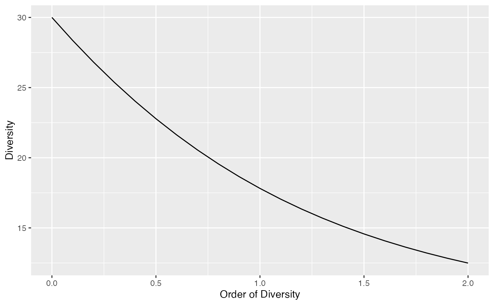
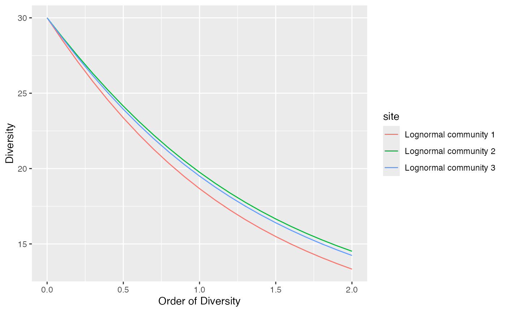

# Migration

*entropart* is being superseded by the
[*divent*](https://ericmarcon.github.io/divent/) package. It will be
maintained, i.e. bugs will be corrected and updates required by CRAN
will be made, but no new development is expected.

## General changes

Object names follow the Pascal-case style in *entropart*, e.g.
[`DivPart()`](https://ericmarcon.github.io/entropart/dev/reference/DivPart.md).
*divent* follows the recommendations of the tidyverse, e.g. snake-case
names with prefixes,
e.g. [`div_part()`](https://ericmarcon.github.io/divent/reference/div_part.html).

Functions’ values are often lists in *entropart*, vs. tibbles in
*divent*, where argument `as_numeric = TRUE` allows obtaining numeric
outputs from many functions.

Abundance or probability data are named vectors in *entropart*, declared
as `AbdVector` or `ProbaVector` objects by the
[`as.AbdVector()`](https://ericmarcon.github.io/entropart/dev/reference/SpeciesDistribution.md)
or
[`as.ProbaVector()`](https://ericmarcon.github.io/entropart/dev/reference/SpeciesDistribution.md)function.
In *divent*, numeric vectors are used directly or converted to tibbles
of class `abundances` or `probabilities` by functions
[`as_abundances()`](https://ericmarcon.github.io/divent/reference/species_distribution.html)
or
[`as_probabilities()`](https://ericmarcon.github.io/divent/reference/species_distribution.html).

The following table shows the correspondence between *entropart* and
*divent* functions.

## Function names

[TABLE]

## Examples

The examples below show how to create a random community with both
packages and estimate its diversity.

``` r

set.seed(97310)
# entropart
library("entropart")
# Random community, lognormal, 1000 individuals, 30 species 
the_community <- entropart::rCommunity(
  n = 1,
  size = 1000, 
  S = 30, 
  Distribution = "lnorm"
)
# Shannon's entropy
Shannon(the_community)
```

    ##  UnveilJ 
    ## 2.880002

``` r

# Shannon's diversity (Hill number of order 1)
Diversity(the_community, q = 1)
```

    ## UnveilJ 
    ## 17.8143

``` r

# Diversity profile
CommunityProfile(Diversity, the_community) |>
  autoplot()
```



*divent* supports multiple communities.

``` r

# divent
library("divent")
```

    ## Loading required package: Rcpp

``` r

library("tidyverse")
```

    ## ── Attaching core tidyverse packages ──────────────────────── tidyverse 2.0.0 ──
    ## ✔ dplyr     1.2.1     ✔ readr     2.2.0
    ## ✔ forcats   1.0.1     ✔ stringr   1.6.0
    ## ✔ ggplot2   4.0.4     ✔ tibble    3.3.1
    ## ✔ lubridate 1.9.5     ✔ tidyr     1.3.2
    ## ✔ purrr     1.2.2

    ## ── Conflicts ────────────────────────────────────────── tidyverse_conflicts() ──
    ## ✖ dplyr::filter() masks stats::filter()
    ## ✖ dplyr::lag()    masks stats::lag()
    ## ℹ Use the conflicted package (<http://conflicted.r-lib.org/>) to force all conflicts to become errors

``` r

# 3 random communities, lognormal, 1000 individuals, 30 species 
rcommunity(
  n = 3, 
  size = 1000, 
  species_number = 30, 
  distribution = "lnorm"
) |>
  # Give it a name
  mutate(site = paste("Lognormal community", 1:3)) ->
  the_communities
# Shannon's entropy
ent_shannon(the_communities)
```

    ## # A tibble: 3 × 5
    ##   site                  weight estimator order entropy
    ##   <chr>                  <dbl> <chr>     <dbl>   <dbl>
    ## 1 Lognormal community 1   1000 UnveilJ       1    2.93
    ## 2 Lognormal community 2   1000 UnveilJ       1    2.98
    ## 3 Lognormal community 3   1000 UnveilJ       1    2.97

``` r

# Shannon's diversity, numeric values
div_hill(the_communities, q = 1, as_numeric = TRUE)
```

    ## [1] 18.66929 19.75556 19.50123

``` r

# Diversity profile
profile_hill(the_communities) |>
  autoplot()
```


